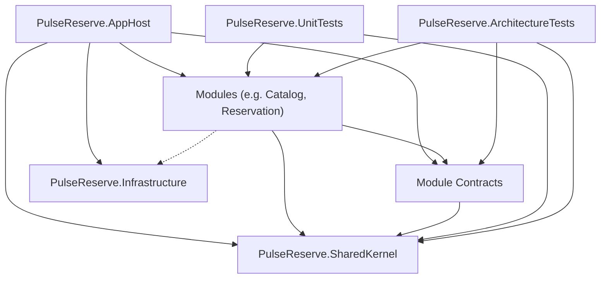

# Repository Structure & Organization Standards

**Project:** PulseReserve  
**Architecture:** Modular Monolith (.NET 9 / ASP.NET Core 9)  
**Status:** Active Standard  

---

## 1. Repository Structure Overview

PulseReserve maintains a strict separation between Host, Shared components, Bounded Context Modules, Tests, and Architectural Documentation.

```text
PulseReserve/
│
├── docs/
│   ├── architecture/
│   │   ├── 01-architecture-contract.md
│   │   ├── 01-repository-structure.md
│   │   └── 02-catalog-domain-model.md
│   └── decisions/
│
├── src/
│   ├── PulseReserve.AppHost/
│   │
│   ├── Shared/
│   │   ├── PulseReserve.SharedKernel/
│   │   │   ├── Domain/
│   │   │   │   ├── Entities/
│   │   │   │   ├── Events/
│   │   │   │   ├── Results/
│   │   │   │   └── ValueObjects/
│   │   │   ├── IDateTimeProvider.cs
│   │   │   └── SharedKernelModule.cs
│   │   │
│   │   └── PulseReserve.Infrastructure/
│   │
│   └── Modules/
│       ├── Catalog/
│       │   ├── PulseReserve.Modules.Catalog/
│       │   │   └── Domain/
│       │   │       ├── Events/
│       │   │       ├── SeatingLayouts/
│       │   │       ├── ValueObjects/
│       │   │       └── Venues/
│       │   └── PulseReserve.Modules.Catalog.Contracts/
│       │       ├── Dtos/
│       │       ├── Events/
│       │       └── Ids/
│       │
│       ├── Reservation/
│       │   ├── PulseReserve.Modules.Reservation/
│       │   └── PulseReserve.Modules.Reservation.Contracts/
│       │
│       ├── Identity/
│       │   ├── PulseReserve.Modules.Identity/
│       │   └── PulseReserve.Modules.Identity.Contracts/
│       │
│       ├── Payments/
│       │   ├── PulseReserve.Modules.Payments/
│       │   └── PulseReserve.Modules.Payments.Contracts/
│       │
│       └── Notifications/
│           ├── PulseReserve.Modules.Notifications/
│           └── PulseReserve.Modules.Notifications.Contracts/
│
└── tests/
    ├── PulseReserve.ArchitectureTests/
    │   ├── Catalog/
    │   └── Modules/
    ├── PulseReserve.UnitTests/
    │   └── Catalog/
    │       └── Domain/
    │           ├── Events/
    │           └── SeatingLayouts/
    └── PulseReserve.IntegrationTests/
```

---

## 2. Project Responsibilities

| Project | Responsibility | Allowed Outward References |
| :--- | :--- | :--- |
| `PulseReserve.AppHost` | ASP.NET Core host entrypoint; registers modules, middleware, and dependency injection. | All Modules, Contracts, Shared projects |
| `PulseReserve.SharedKernel` | Zero-dependency core DDD abstractions (`Entity`, `AggregateRoot`, `ValueObject`, `IDomainEvent`, `Result`, `Error`). | None (standard library only) |
| `PulseReserve.Infrastructure` | Shared cross-cutting technical implementations (e.g. database interceptors, global telemetry). | `PulseReserve.SharedKernel` |
| `PulseReserve.Modules.<Module>` | Internal implementation of a bounded context: Domain models, Features, and Module-specific Infrastructure. | `PulseReserve.SharedKernel`, own `.Contracts`, (other module `.Contracts` if approved) |
| `PulseReserve.Modules.<Module>.Contracts` | Public DTOs, strongly typed IDs, and integration events exposed to other modules and host. | `PulseReserve.SharedKernel` only |
| `PulseReserve.ArchitectureTests` | Automated boundary, dependency, and naming assertions using `NetArchTest.Rules`. | All projects (test harness) |
| `PulseReserve.UnitTests` | Fast, deterministic domain logic, invariant validation, and value object unit tests. | Unit under test + `SharedKernel` |
| `PulseReserve.IntegrationTests` | End-to-end integration tests using Testcontainers (PostgreSQL, Redis, Kafka). | Host and target module contracts |

---

## 3. Module Structure (2-Project Vertical Slice)

Each bounded context is isolated into exactly two projects:
1. `PulseReserve.Modules.<Module>` (Internal)
2. `PulseReserve.Modules.<Module>.Contracts` (Public)

Inside `PulseReserve.Modules.<Module>`:
```text
PulseReserve.Modules.<Module>/
├── Domain/           -> Pure domain model (Entities, Value Objects, Domain Events)
├── Features/         -> Vertical slice use cases (Commands, Queries, Handlers, Validators) [when implemented]
├── Application/      -> Application-level orchestration and domain event handlers [when implemented]
└── Infrastructure/   -> EF Core DbContext, migrations, repositories, external adapters [when implemented]
```
> **Rule:** Folders are created only when they contain actual production code. Empty placeholder folders are forbidden.

---

## 4. Domain Organization

The `Domain/` directory inside a module must remain 100% free of infrastructure, database annotations, HTTP, and messaging dependencies.

Organization is strictly **concept-based**, grouping related aggregates and child entities:

```text
Domain/
├── Events/
│   ├── Event.cs                 (Aggregate Root)
│   ├── EventStatus.cs           (Domain Enum)
│   └── EventDomainEvents.cs     (Domain Events)
│
├── SeatingLayouts/
│   ├── SeatingLayout.cs         (Aggregate Root)
│   ├── Section.cs               (Entity)
│   ├── Row.cs                   (Entity)
│   ├── Seat.cs                  (Entity)
│   └── PriceTier.cs             (Entity)
│
├── Venues/
│   └── Venue.cs                 (Aggregate Root)
│
└── ValueObjects/
    ├── Address.cs               (Value Object)
    ├── Money.cs                 (Value Object)
    └── SeatCoordinate.cs        (Value Object)
```

Flattening all entities into an unstructured root `Domain/` directory is prohibited.

---

## 5. Contracts Organization

The `.Contracts` project contains public cross-module types and must never expose internal domain aggregates, EF Core models, or persistence schemas.

Types within Contracts are organized by functional role:
```text
PulseReserve.Modules.<Module>.Contracts/
├── Dtos/
│   ├── EventCatalogDto.cs
│   └── SeatMetadataDto.cs
│
├── Events/
│   ├── EventPublishedIntegrationEvent.cs
│   ├── EventOnSaleIntegrationEvent.cs
│   └── EventCancelledIntegrationEvent.cs
│
└── Ids/
    └── Ids.cs (Strongly typed record IDs: EventId, VenueId, SeatingLayoutId, etc.)
```

Integration events are separated into individual, focused files to optimize maintainability and discoverability.

---

## 6. Test Organization

Test suites mirror production concepts and namespaces:

### Unit Tests (`PulseReserve.UnitTests`)
Organized by Target Module $\rightarrow$ Layer $\rightarrow$ Concept:
```text
PulseReserve.UnitTests/
└── Catalog/
    └── Domain/
        ├── Events/
        │   └── EventDomainTests.cs
        └── SeatingLayouts/
            └── SeatingLayoutDomainTests.cs
```

### Architecture Tests (`PulseReserve.ArchitectureTests`)
Organized by architectural boundary:
```text
PulseReserve.ArchitectureTests/
├── Catalog/
│   └── CatalogArchitectureTests.cs
└── Modules/
    └── ModuleBoundaryTests.cs
```

---

## 7. Folder and File Naming Conventions

* **PascalCase:** All folders and filenames use PascalCase (e.g. `SeatingLayouts`, `ValueObjects`, `EventDomainTests.cs`).
* **One Primary Type per File:** Each aggregate, entity, DTO, and integration event resides in its own dedicated file named after the type.
* **Prohibited Generic Folders:** Avoid vague folders such as `Models/`, `Helpers/`, `Utils/`, `Common/`, `Stuff/`, `Misc/`, `Services/`, or `Managers/`. Folder names must represent concrete domain concepts or architectural components.

---

## 8. Namespace Conventions

Namespaces must match their directory location within the project to ensure predictable navigation:

* `src/Modules/Catalog/PulseReserve.Modules.Catalog/Domain/Events/` $\rightarrow$ `PulseReserve.Modules.Catalog.Domain.Events`
* `src/Modules/Catalog/PulseReserve.Modules.Catalog/Domain/SeatingLayouts/` $\rightarrow$ `PulseReserve.Modules.Catalog.Domain.SeatingLayouts`
* `src/Modules/Catalog/PulseReserve.Modules.Catalog/Domain/ValueObjects/` $\rightarrow$ `PulseReserve.Modules.Catalog.Domain.ValueObjects`
* `src/Modules/Catalog/PulseReserve.Modules.Catalog.Contracts/Dtos/` $\rightarrow$ `PulseReserve.Modules.Catalog.Contracts.Dtos`
* `src/Modules/Catalog/PulseReserve.Modules.Catalog.Contracts/Events/` $\rightarrow$ `PulseReserve.Modules.Catalog.Contracts.Events`
* `tests/PulseReserve.UnitTests/Catalog/Domain/Events/` $\rightarrow$ `PulseReserve.UnitTests.Catalog.Domain.Events`

*Note on SharedKernel:* To preserve backward compatibility and prevent unnecessary namespace fragmentation across consumers, core primitives retain `namespace PulseReserve.SharedKernel;` while their physical files reside in categorized directories (`Domain/Entities/`, `Domain/Events/`, `Domain/ValueObjects/`, `Domain/Results/`).

---

## 9. Dependency Boundaries & Enforcement

The architecture enforces strict unidirectional dependency rules:



### Invariants:
1. **No Module-to-Module Internal References:** `PulseReserve.Modules.Reservation` cannot reference `PulseReserve.Modules.Catalog`. It may only reference `PulseReserve.Modules.Catalog.Contracts`.
2. **Contracts Isolation:** `.Contracts` projects must never reference internal module projects or infrastructure packages.
3. **SharedKernel Purity:** `PulseReserve.SharedKernel` must never reference module projects, contracts, or infrastructure packages.
4. **Domain Purity:** Module `Domain/` code must never reference EF Core, database drivers, or external frameworks.
