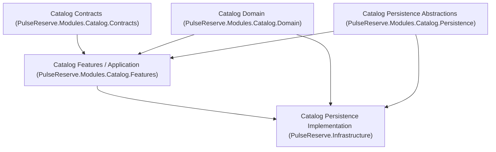
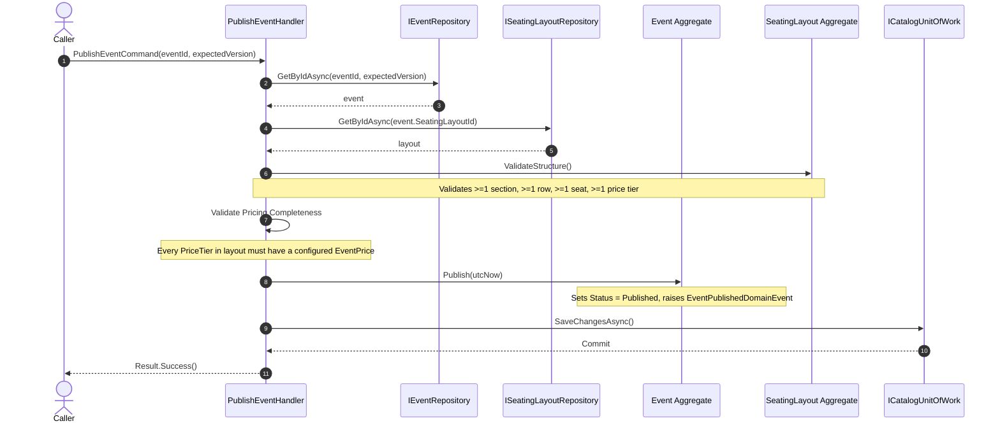
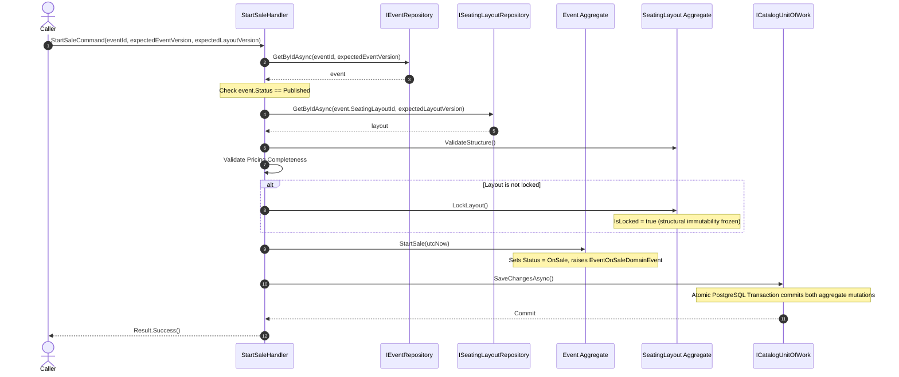

# 08 — Catalog Application Layer & Use-Case Orchestration

## 1. Application Layer Responsibility

The Catalog Application Layer (`PulseReserve.Modules.Catalog.Features`) provides vertical-slice use-case orchestration connecting business intent with domain aggregate behaviors and persistence boundaries. It coordinates operations across aggregates without introducing HTTP/API concerns, controllers, MediatR, or CQRS libraries.

Key responsibilities:
- **Command & Query Handling**: Pure C# handlers executing discrete business actions across Venues, SeatingLayouts, and Events.
- **Cross-Aggregate Orchestration**: Enforcing business preconditions spanning multiple aggregate boundaries (e.g., verifying seating layout structural validity and price coverage before event publication or sale start).
- **Persistence Coordination**: Loading domain aggregates, passing concurrency expectations, invoking domain methods, and persisting state changes atomically via `ICatalogUnitOfWork`.
- **Domain Decoupling**: Preserving domain purity by keeping aggregate roots persistence-ignorant and free from infrastructure libraries.

---

## 2. Dependency Direction

PulseReserve enforces a strict inward dependency direction:

- **Catalog Domain** has zero external dependencies; it depends solely on `SharedKernel` primitives.
- **Catalog Features (Application)** depend on `Catalog.Domain`, `Catalog.Contracts`, `Catalog.Persistence`, and `SharedKernel`. It has zero dependencies on `Microsoft.EntityFrameworkCore`, `Npgsql`, PostgreSQL, or `PulseReserve.Infrastructure`.
- **Catalog Persistence Abstractions** reside in `PulseReserve.Modules.Catalog.Persistence` and define only the contract required by application use cases.
- **PulseReserve.Infrastructure** implements the persistence interfaces using `CatalogDbContext`.

---

## 3. Persistence Boundary & Why Generic Repositories Were Rejected

### The Catalog Persistence Boundary

Rather than inventing generic repository abstractions (`IRepository<T>`) or a generic `IUnitOfWork`, the Catalog module defines explicit, domain-specific persistence contracts:

- [`IVenueRepository`](file:///f:/Course/github/PulseReserve/src/Modules/Catalog/PulseReserve.Modules.Catalog/Persistence/IVenueRepository.cs): `AddAsync`, `GetByIdAsync`, `ExistsAsync`.
- [`ISeatingLayoutRepository`](file:///f:/Course/github/PulseReserve/src/Modules/Catalog/PulseReserve.Modules.Catalog/Persistence/ISeatingLayoutRepository.cs): `AddAsync`, `GetByIdAsync(id, expectedVersion)`, `ExistsAsync`.
- [`IEventRepository`](file:///f:/Course/github/PulseReserve/src/Modules/Catalog/PulseReserve.Modules.Catalog/Persistence/IEventRepository.cs): `AddAsync`, `GetByIdAsync(id, expectedVersion)`, `ExistsAsync`.
- [`ICatalogUnitOfWork`](file:///f:/Course/github/PulseReserve/src/Modules/Catalog/PulseReserve.Modules.Catalog/Persistence/ICatalogUnitOfWork.cs): `SaveChangesAsync(cancellationToken)`.

### Rationale: Rejection of Generic Repositories

1. **Leaky & Untyped Abstractions**: Generic repositories like `IRepository<T>` often expose operations (`GetAll`, `Find(Expression<Func<T, bool>>)`) that leak query concerns or encourage anemic domain models where aggregates are loaded without their essential child boundaries.
2. **Aggregate-Root Boundary Enforcement**: `ISeatingLayoutRepository` always loads the complete aggregate tree (`Sections`, `Rows`, `Seats`, `PriceTiers`) eagerly. Aggregate child entities are never queried or mutated outside the aggregate root boundary.
3. **Concurrency-Aware Contracts**: Bounded-context repositories accept `expectedVersion` parameters to participate directly in the aggregate-level optimistic concurrency check without application code interacting with EF Core `PropertyEntry` APIs.
4. **No Abstraction for Abstraction's Sake**: Explicit interfaces define only the access patterns actually needed by the Catalog features, making tests simpler, clearer, and free of generic mock boilerplate.

---

## 4. Cross-Aggregate Orchestration

The Catalog bounded context maintains three aggregate roots: `Venue`, `SeatingLayout`, and `Event`. Aggregates maintain consistency only within their own boundaries and reference external aggregates strictly by identifier (`VenueId`, `SeatingLayoutId`).

Complex business workflows spanning multiple aggregates are coordinated by Application Layer feature handlers:

### 4.1 PublishEvent Workflow

- **Layout Structural Validation**: Verifies that the referenced seating layout has at least one section, row, seat, and price tier before publication.
- **Pricing Completeness Check**: Verifies that every `PriceTier` defined in the layout has a configured price in `Event.Prices`.
- **SeatingLayout State**: Notice that `PublishEvent` does **NOT** lock the seating layout. Layout structure can still be modified while the event is in `Draft` or `Published` states.

---

### 4.2 StartSale Workflow

- **Precondition**: The event must be in `Published` state before transitioning to `OnSale`.
- **Layout Freezing**: Upon sale start, `SeatingLayout.LockLayout()` is invoked, permanently rendering the physical seating layout immutable. Subsequent structural alterations (`AddSection`, `AddRow`, `AddSeat`, `AddPriceTier`) are rejected by domain rules.
- **Multi-Aggregate Atomicity**: Both `SeatingLayout` (locking) and `Event` (status transition to `OnSale`) are persisted within an atomic PostgreSQL transaction.

---

## 5. Transaction Boundaries & Atomicity

For multi-aggregate workflows (`PublishEvent`, `StartSale`), persistence is strictly atomic:

- When `CatalogUnitOfWork.SaveChangesAsync` is called, Entity Framework Core executes all pending inserts, updates, and deletes within a single PostgreSQL database transaction (`BEGIN ... COMMIT`).
- If any entity mutation violates a concurrency token, database constraint, or check constraint, PostgreSQL aborts the transaction (`ROLLBACK`).
- As proven by `MultiAggregate_AtomicityRollback_WhenWorkflowFails_NoPartialChangesPersisted`, failure in any part of the multi-aggregate workflow leaves both `catalog.events` and `catalog.seating_layouts` completely unmodified in PostgreSQL.

---

## 6. Optimistic Concurrency Interaction

The Catalog application layer works in synergy with the established Phase 2B aggregate concurrency architecture:

1. **Shadow Token Integration**: Concurrency tokens reside on the aggregate roots (`catalog.venues.version`, `catalog.seating_layouts.version`, `catalog.events.version`).
2. **ExpectedVersion Propagation**: Feature commands accept optional `ExpectedVersion` parameters. When specified, the repository assigns `_context.Entry(aggregate).Property<int>("Version").OriginalValue = expectedVersion.Value`.
3. **Deterministic Stale Update Rejection**: If the database version differs from the expected version, EF Core generates `WHERE id = @id AND version = @expectedVersion`. Because zero rows are updated, EF Core throws `DbUpdateConcurrencyException`.
4. **Zero Exception Swallowing**: Handlers do NOT catch or suppress `DbUpdateConcurrencyException`, allowing infrastructure-level concurrency failures to bubble up cleanly to the caller without data corruption.

---

## 7. Deferred Concerns (Strict Boundary Discipline)

The following capabilities are deliberately excluded from Phase 2C and reserved for future phases:

- **HTTP / REST APIs**: ASP.NET Core endpoints, controllers, Minimal API routes, and Swagger documentation (Phase 2D).
- **Cross-Module Messaging**: Kafka message producers, Redis caching, MassTransit, and Outbox/Inbox tables (Phase 2E+).
- **Reservation Domain Logic**: Inventory reservation holds, expiration timers, and seat locking (Phase 3).
- **Payment Processing**: Payment intents, webhook verification, and refund orchestration (Phase 4).
- **External Framework Abstractions**: MediatR, CQRS dispatchers, or generic query specifications.
