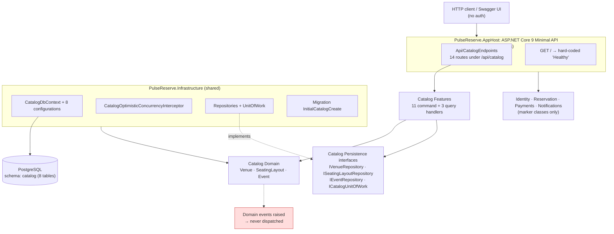
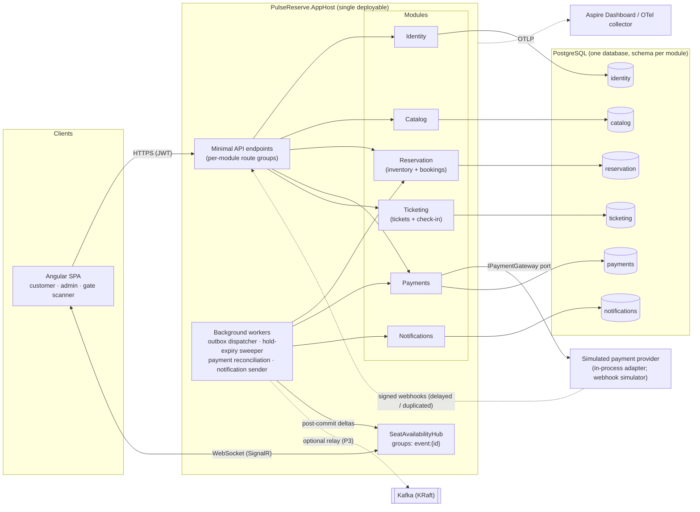

# Architecture Document 09: System Audit, Gap Analysis & Target Architecture Roadmap

**Project:** PulseReserve
**Document type:** Evidence-based audit + implementation plan (analysis only; no code changed)
**Audit date:** 2026-10-20
**Audited state:** commit `41b2ef4` (`chore(repo): establish PulseReserve architecture baseline`) **plus the uncommitted working tree** (Catalog persistence, application layer, Minimal API, and tests are all untracked or modified, not committed)
**Status:** **Proposed. Awaiting approval.** None of the decisions in §12 have been accepted.

> **Reading guide.** §1–§4 cover what exists today and what is missing. §5–§10 describe the target design. §11 is the phased roadmap and §12 lists the decisions that need ADRs. Each claim about current behaviour points to a file and line. Anything not verified by running code is labelled **Unverified**.

---

## Table of Contents

1. [Executive Summary](#1-executive-summary)
2. [Current Architecture](#2-current-architecture)
3. [Existing Feature Inventory](#3-existing-feature-inventory)
4. [Gap Analysis](#4-gap-analysis)
5. [Recommended Technology Stack](#5-recommended-technology-stack)
6. [Proposed Module Boundaries](#6-proposed-module-boundaries)
7. [Critical End-to-End Flows](#7-critical-end-to-end-flows)
8. [Data and Consistency Design](#8-data-and-consistency-design)
9. [Security and Abuse Prevention](#9-security-and-abuse-prevention)
10. [Testing and Observability Plan](#10-testing-and-observability-plan)
11. [Phased Implementation Roadmap](#11-phased-implementation-roadmap)
12. [Architecture Decision Records](#12-architecture-decision-records)
- [Appendix A: Audit Method, Commands Run & Limitations](#appendix-a-audit-method-commands-run--limitations)
- [Appendix B: Documentation Discrepancies](#appendix-b-documentation-discrepancies)

---

## 1. Executive Summary

### 1.1 What the system is today

PulseReserve is an **early-stage backend-only modular monolith** on .NET 9. Only one bounded context, **Catalog** (venues, seating layouts, events, event-scoped pricing), contains real code. That code is careful and well tested at the domain level: the aggregates are pure, the PostgreSQL schema uses composite foreign keys for hierarchical integrity, and aggregate-level optimistic concurrency is enforced by an EF Core interceptor.

The other four modules (**Identity, Reservation, Payments, Notifications**) are **empty shells**. Each contains one static `Name` property and one marker interface.

The repository contains **no ticket-booking capability**:

- seat holds
- bookings
- payments
- tickets
- QR codes
- check-in
- authentication
- messaging
- real-time updates
- Angular frontend
- Docker configuration
- CI pipeline

### 1.2 Maturity assessment

| Area | Maturity | Evidence |
| :--- | :--- | :--- |
| Catalog domain model | **Good** | 26 domain unit tests pass. Invariants are explicit (`Event.cs`, `SeatingLayout.cs`). |
| Catalog persistence | **Good, with defects** | Composite FKs and the concurrency interceptor are solid. Unique indexes and the aggregate load strategy are flawed (§4, P1–P3). |
| Catalog application layer | **Adequate** | 11 commands and 3 queries are implemented and unit tested against fakes. |
| HTTP API | **Broken** | `PulseReserve.AppHost` **does not compile**: 14 errors (§1.3). |
| Booking / Payments / Ticketing / Check-in | **Absent** | Only marker classes exist (`src/Modules/*/Module.cs`). |
| Security | **Absent** | No authentication or authorization of any kind. Every endpoint is anonymous. |
| Messaging / Outbox / Kafka | **Absent** | Domain events are raised and then discarded. Integration event contracts are never published. |
| Real-time (SignalR) | **Absent** | — |
| Observability | **Absent** | No logging calls, health checks, metrics, or OpenTelemetry. `/` returns a hard-coded `"Healthy"`. |
| Frontend (Angular) | **Absent** | No `package.json` or `angular.json`. `.gitignore` describes the frontend as "Planned". |
| DevOps | **Absent** | No Dockerfile, compose file, CI workflow, or `global.json`. |

### 1.3 Most important findings

1. **The host does not build (blocker).** `src/PulseReserve.AppHost/Api/CatalogEndpoints.cs` has two problems:
   - It calls `.WithOpenApi()`, which needs the `Microsoft.AspNetCore.OpenApi` package. That package is not referenced (9 errors).
   - `EventId` is ambiguous with `Microsoft.Extensions.Logging.EventId` because of Web SDK implicit usings (5 errors).

   As a result, the **architecture tests and integration tests cannot be compiled or run**, because both reference the AppHost project. The "129 passing tests" claim in `PROJECT.md` **cannot be reproduced** on the current working tree. Only the 60 unit tests run, and all 60 pass.
2. **Domain bug in the event lifecycle.** `Event.Publish` ([Event.cs:87](../../src/Modules/Catalog/PulseReserve.Modules.Catalog/Domain/Events/Event.cs)) rejects only `Cancelled` and `Closed`. An `OnSale` event can therefore be "published" again, which:
   - moves it back to `Published`
   - overwrites `PublishedAtUtc`
   - allows `StartSale` to run a second time

   `PublishEventHandler` does not guard against this either ([PublishEventHandler.cs:63](../../src/Modules/Catalog/PulseReserve.Modules.Catalog/Features/Events/PublishEvent/PublishEventHandler.cs)), and no test covers it. Once a Reservation module depends on `OnSale` status, this becomes a correctness defect.
3. **Seating layout loads cause a cartesian explosion.** `SeatingLayoutRepository.GetByIdAsync` ([SeatingLayoutRepository.cs:28](../../src/Shared/PulseReserve.Infrastructure/Persistence/Catalog/Repositories/SeatingLayoutRepository.cs)) uses four sibling collection `Include`s without `AsSplitQuery()`. The SQL join result grows as *sections × rows × seats × tiers*. In addition, every `AddSeat` loads the whole layout. Building a stadium-sized layout through this API is therefore impractical. This contradicts the 50,000-seat rationale in ADR-003.
4. **"Case-insensitive" unique indexes are case-sensitive.** `uq_sections_layout_name_lower`, `uq_rows_section_label_lower`, and `uq_seats_row_label_lower` are plain `(…, name)` indexes in the migration. They are not `lower(name)` functional indexes as documented in doc 03 §8/§14. The case-insensitive rule exists only in the domain.
5. **The documented concurrency strategy is a design, not an implementation.** README/PROJECT/ADR-002 describe a partial unique index on `reservation.seat_reservations`, Redis Lua leases, a Kafka outbox, and "sub-100 ms critical path". **None of these exist.** No benchmark supports the latency claim.
6. **The module persistence placement contradicts the architecture contract.** `PulseReserve.Infrastructure` references the Catalog *implementation* project ([PulseReserve.Infrastructure.csproj:4](../../src/Shared/PulseReserve.Infrastructure/PulseReserve.Infrastructure.csproj)). Contract 01 §4 rule 6 says Infrastructure references SharedKernel only. If every module's persistence lands in this shared assembly, module isolation erodes over time.
7. **.NET 9 support window.** `Directory.Build.props` targets `net9.0`, a Standard Term Support release. Under Microsoft's current STS policy (24 months), .NET 9 support ends around **10 November 2026**, three weeks after this audit. *Verify against the official .NET support policy page before deciding.* Upgrading is out of scope for this phase but must be an explicit roadmap decision (Phase 0).

### 1.4 Recommendation in one paragraph

1. Stabilise first: fix the build, fix the lifecycle bug, make the test suites reproducible in CI with a containerised PostgreSQL, and decide the .NET target.
2. Then build the booking core on **PostgreSQL alone**:
   - a per-event seat inventory table
   - atomic conditional updates using `FOR UPDATE SKIP LOCKED`
   - a database-enforced hold-per-customer limit
   - a background expiry sweeper
3. Add a **transactional outbox per module**, dispatched in-process, *before* introducing Kafka.
4. Add a simulated payment provider behind a port, with provider-side idempotency keys and a reconciliation job.
5. Issue tickets asynchronously with **opaque random QR tokens stored hashed**, and check them in with a single conditional `UPDATE`.
6. Add **SignalR** for single-instance availability deltas.

Redis and Kafka should be added only when a documented trigger occurs (§5). For Kafka, a reasonable trigger is a deliberate portfolio goal of demonstrating an external event stream.

---

## 2. Current Architecture

### 2.1 Projects (16) and actual dependencies

| Project | Contents (verified) | References |
| :--- | :--- | :--- |
| `src/PulseReserve.AppHost` | Minimal API host. 14 Catalog routes in `Api/CatalogEndpoints.cs`, `ErrorMapping.cs`, `ApiContracts.cs`. Swagger. **Does not compile.** | All 5 module implementation projects, SharedKernel, Infrastructure. `Swashbuckle.AspNetCore`, `EF Core Design` |
| `src/Shared/PulseReserve.SharedKernel` | `Entity<TId>`, `AggregateRoot<TId>` (domain event list, **no Version**), `ValueObject`, `Result`/`Result<T>`, `Error`, `IDomainEvent`, `IDateTimeProvider` | none |
| `src/Shared/PulseReserve.Infrastructure` | `CatalogDbContext`, 8 entity configurations, ID converters, `CatalogOptimisticConcurrencyInterceptor`, repositories, unit of work, migration `20261003131943_InitialCatalogCreate`, `SystemDateTimeProvider`, DI registration of handlers | SharedKernel, **Catalog implementation**, EF Core 9.0.4, Npgsql EF 9.0.4 |
| `Modules/Catalog/PulseReserve.Modules.Catalog` | `Domain/` (3 aggregates, 4 entities, 3 value objects, 3 domain events), `Features/` (11 commands, 3 queries), `Persistence/` (4 interfaces) | SharedKernel, Catalog.Contracts |
| `Modules/Catalog/PulseReserve.Modules.Catalog.Contracts` | 7 strongly-typed IDs, 2 DTOs (unused), 3 integration events (unused) | SharedKernel |
| `Modules/{Identity,Reservation,Payments,Notifications}` (+ `.Contracts`) | **One static class and one marker interface each** | SharedKernel, own Contracts |
| `tests/PulseReserve.UnitTests` | 60 tests: domain and feature handlers against in-memory fakes | Infrastructure + all modules |
| `tests/PulseReserve.ArchitectureTests` | 44 test methods: NetArchTest rules, EF model metadata, interceptor | AppHost (hence blocked by the build failure) |
| `tests/PulseReserve.IntegrationTests` | 10 tests against a *local* PostgreSQL. No Testcontainers. Migrates and truncates `pulsereserve_test`. | AppHost (blocked) |

**Package baseline** (`Directory.Packages.props`, central package management with transitive pinning):

| Category | Package | Version |
| :--- | :--- | :--- |
| Persistence | EF Core | 9.0.4 |
| Persistence | Npgsql EF provider | 9.0.4 |
| API docs | Swashbuckle | 10.2.3 |
| Testing | xUnit | 2.9.2 |
| Testing | FluentAssertions | 6.12.2 |
| Testing | NetArchTest | 1.3.2 |
| Testing | coverlet | — |

There is **no** Polly, `Microsoft.Extensions.Http.Resilience`, OpenTelemetry, SignalR client, Kafka, Redis, Identity, or health-check package. `Directory.Build.props` sets `TreatWarningsAsErrors`, `Nullable`, and C# 13. The installed SDK is 10.0.401, and there is no `global.json` pin.

### 2.2 Current architecture diagram



### 2.3 Runtime flows that actually exist

There is exactly **one runtime flow type**, synchronous Catalog administration:

```text
HTTP POST /api/catalog/...  →  endpoint lambda (maps request, catches DbUpdateConcurrencyException → 409)
  → Handler.HandleAsync      →  repository.GetByIdAsync(id, expectedVersion?)   (tracked, full aggregate)
  → aggregate method (Result) →  ICatalogUnitOfWork.SaveChangesAsync
  → interceptor bumps root version once  →  single implicit PostgreSQL transaction (EF SaveChanges)
```

- **Multi-aggregate atomicity** (for example `StartSale` locking a layout and transitioning the event) relies on one `SaveChanges` call, which is a single transaction. This is correct as implemented. It is covered by `MultiAggregate_AtomicityRollback_…` (integration test, *not runnable at audit time*).
- **No background processing exists.** There are no `BackgroundService`/`IHostedService` classes, no scheduled jobs, and no consumers.

### 2.4 Data ownership today

| Data | Owner | Store |
| :--- | :--- | :--- |
| Venues, seating layouts (sections/rows/seats/price tiers), events, event prices | Catalog | `catalog.*` (8 tables, migration `20261003131943`) |
| Users, reservations, payments, tickets, notifications | *nobody (not implemented)* | — |

The `catalog.seats` table correctly contains **no** reservation state. The architecture test `Model_CatalogSeat_MustNotContain_ReservationStateFields` enforces this. That is a good foundation for the inventory design in §8.

---

## 3. Existing Feature Inventory

**Legend:**

- ✅ **Implemented & verified by code** (and a passing test run in this audit)
- 🟡 **Partially implemented**
- 🟠 **Present but incomplete or not sufficiently verified** (code exists, but tests could not run or behaviour is wrong)
- ❌ **Missing**

### 3.1 Catalog

| Feature | Status | Evidence |
| :--- | :---: | :--- |
| Venue create/read, address value object | ✅ | `Domain/Venues/Venue.cs`, `Features/Venues/*`, `VenueFeatureTests` (unit, passed) |
| Seating layout authoring (sections, rows, seats, price tiers) with scoped uniqueness | ✅ (domain) / 🟠 (DB) | `SeatingLayout.cs` checks case-insensitively. **DB indexes are case-sensitive** (migration lines ~298–347). |
| Layout structural validation and lock | ✅ | `SeatingLayout.ValidateStructure/LockLayout`, `SeatingLayoutDomainTests` |
| Event lifecycle Draft→Published→OnSale | 🟠 | Works on the happy path. **OnSale→Published regression bug** (`Event.cs:87`). `Close` (`Event.cs:120`) records no timestamp or domain event. |
| Event cancel / close use cases | 🟡 | Domain methods exist. **No handler or endpoint.** |
| Event-scoped pricing with composite-FK integrity | ✅ (model) / 🟠 (runtime) | `EventPriceConfiguration.cs`, `Model_EventPrice_MustUseCompositeRelationships…` (arch, *not runnable*) |
| Pricing immutability once OnSale | ✅ | `Event.SetPrice`, `SetPrice_WhenEventIsOnSale_ShouldFail…` |
| Layout lock at StartSale (ADR-006), atomic with event transition | 🟠 | `StartSaleHandler.cs`. The atomicity test exists but was not runnable. |
| Aggregate-level optimistic concurrency | 🟠 | Interceptor plus 9 interceptor tests and 6 PostgreSQL tests. **None runnable at audit time.** The design is sound. |
| HTTP API for Catalog (14 routes) | 🟠 | `Api/CatalogEndpoints.cs`. **Does not compile.** No API tests. |
| Optimistic concurrency usable by HTTP clients | 🟡 | Commands accept `ExpectedVersion`, but **no GET response returns a version** (`EventResponse`, `SeatingLayoutResponse`, `VenueResponse`). |
| Public browse/search (list on-sale events, seat map with prices) | ❌ | Only `GetById` queries exist. `EventCatalogDto` and `SeatMetadataDto` are unused. |
| Catalog integration events (EventPublished / OnSale / Cancelled) | 🟡 | Records exist in `Catalog.Contracts/Events/`. **Never published.** Domain events are never dispatched or cleared. |

### 3.2 Target capabilities

| Capability | Status | Evidence |
| :--- | :---: | :--- |
| User registration / login / tokens | ❌ | `Modules/Identity/Module.cs` is a marker only. No auth middleware in `Program.cs`. |
| Role/policy authorization (customer, admin, gate staff) | ❌ | No `[Authorize]`, `RequireAuthorization`, or policies |
| Audit of admin operations | ❌ | — |
| Per-event seat availability | ❌ | — |
| Seat hold / reservation / expiry / release | ❌ | `Modules/Reservation/Module.cs` is a marker only. The partial unique index exists only in docs. |
| Double-booking prevention | ❌ | No reservation tables. The guarantee is documented, not implemented. |
| Simulated payments, idempotency, reconciliation | ❌ | `Modules/Payments/Module.cs` is a marker only |
| Ticket issuance / QR | ❌ | No module exists, not even a stub |
| Staff QR check-in | ❌ | — |
| Notifications | ❌ | Marker only |
| Transactional outbox / inbox / Kafka | ❌ | No tables, packages, or hosted services |
| SignalR real-time availability | ❌ | — |
| Retry / resilience policies | ❌ | No Polly, no `EnableRetryOnFailure`, no HTTP clients |
| Structured logging / correlation / OpenTelemetry / metrics | ❌ | No `ILogger` usage in `src/`. Default console logging only. |
| Health / readiness checks | ❌ | `GET /` returns a constant (`Program.cs:37`) |
| Global exception handling / ProblemDetails | 🟡 | `ErrorMapping.ToProblemResult` for `Result` errors only. Unhandled exceptions give the framework default 500. |
| Rate limiting | ❌ | — |
| Angular frontend | ❌ | — |
| Docker / Compose | ❌ | Docker 29.8.2 is installed on the machine, but the repository has no Docker assets |
| CI/CD | ❌ | No `.github/workflows`. "CI properties" in PROJECT.md refers to `Directory.Build.props`. |
| Load testing | ❌ | k6 is mentioned in the docs only |

### 3.3 Tests

| Suite | Count (methods) | Ran in audit? | Result |
| :--- | :---: | :---: | :--- |
| `PulseReserve.UnitTests` | 60 | **Yes** | **60 passed, 0 failed** (183 ms) |
| `PulseReserve.ArchitectureTests` | 44 (some are theories) | No | **Build failure** (AppHost compile errors) |
| `PulseReserve.IntegrationTests` | 10 | No | **Build failure.** It would also require a local PostgreSQL and would migrate and truncate a local database (see Appendix A). |

---

## 4. Gap Analysis

**Priority scale:**

- **P0**: blocks all further work
- **P1**: essential for the target platform
- **P2**: important hardening
- **P3**: optional enhancement

### 4.1 Defects in existing code

| ID | Gap | Impact | Priority | Proposed solution | Depends on |
| :--- | :--- | :--- | :---: | :--- | :--- |
| A1 | AppHost does not compile (`WithOpenApi`, `EventId` ambiguity) | No running API. Architecture and integration tests unbuildable. Status claims unverifiable. | **P0** | Either remove `.WithOpenApi()` (Swashbuckle reads endpoint metadata without it) or add `Microsoft.AspNetCore.OpenApi` 9.x. Alias `EventId` (`using EventId = PulseReserve.Modules.Catalog.Contracts.EventId;`). | — |
| D1 | `Event.Publish` allows OnSale→Published, so `StartSale` can repeat | Sale state regresses. Duplicate `EventOnSale` events. Reservation inventory could be seeded twice. | **P0** | Allow `Publish` only from `Draft` (and treat `Published` as idempotent no-op or error). Add domain tests for every illegal transition. | — |
| P1 | Cartesian explosion on layout load (4 sibling `Include`s, single query) | Memory/latency blow-up for large layouts. Makes the 50k-seat goal infeasible. | **P1** | `AsSplitQuery()` on the aggregate load (or a global `UseQuerySplittingBehavior`). Measure with a seeded large layout. | A1 |
| P2 | One HTTP call and full-aggregate load per `AddSeat` | O(n²) layout construction | **P1** | Bulk layout import command (`ImportSeatingLayout` with a sections/rows/seats document), validated in-memory, saved once | P1 |
| P3 | `_lower` unique indexes are case-sensitive | DB does not back the documented invariant. Direct SQL or future code paths can insert `"VIP"` and `"vip"`. | **P2** | New migration with `lower()` expression indexes (raw SQL in migration) or a `citext`/ICU nondeterministic collation. **Requires a migration, so it needs approval.** | A1 |
| D2 | `Event.Close` sets no timestamp and raises no event | Reservation/Ticketing cannot react to sales closing | **P2** | Add `ClosedAtUtc` and `EventClosedDomainEvent`. Add Close/Cancel handlers and endpoints. | Outbox (Phase 3) |
| D3 | Domain events never dispatched or cleared | Integration contracts are dead code. Cross-module reactions are impossible. | **P1** | Outbox interceptor converts domain events to outbox rows in the same transaction (§7.5) | — |
| D4 | `Money` accepts any 3 characters (`"1$A"`) | Invalid currencies reach payments | **P2** | Validate `[A-Z]{3}` (optionally against an ISO 4217 allow-list). Consider moving `Money` to SharedKernel for Payments/Reservation reuse. | — |
| A2 | `DateTime` request fields with `Kind=Unspecified/Local` | Npgsql 6+ rejects non-UTC `DateTime` for `timestamptz`, so the client gets a **500** when it omits `Z`. **Unverified at runtime in this audit.** | **P2** | Use `DateTimeOffset` in API contracts and convert to UTC, or validate `Kind == Utc` and return 400 | A1 |
| A3 | No global exception handler. Concurrency `catch` duplicated in 8 endpoints. Non-concurrency `DbUpdateException` (FK/unique/check violation) gives 500. | Information leakage risk. Inconsistent responses. | **P1** | `AddProblemDetails()` + `IExceptionHandler`. Map `DbUpdateConcurrencyException`→409 and `PostgresException` 23505→409, 23503/23514→400/422, centrally. | A1 |
| A4 | Versions not exposed on reads | Clients cannot use optimistic concurrency, so lost updates across user think-time are undetectable | **P2** | Return `version` in responses and/or `ETag`. Accept `If-Match`. | A1 |
| A5 | `ErrorMapping` classifies by substring (`"NotFound"`) | `SeatingLayout.ParentSectionNotFound` (an invalid request body) becomes **404** | **P2** | Add an `ErrorType` (Validation/NotFound/Conflict/Forbidden) to `Error` and map by type | — |
| A6 | `Program.cs:16` prefers env var `PULSERESERVE_TEST_DATABASE` over `ConnectionStrings:Catalog` in the runtime host | A test-only variable silently overrides production configuration | **P2** | Use standard configuration only (`ConnectionStrings__Catalog` env var already works). Keep the test variable in test fixtures. | — |
| A7 | `/` returns a hard-coded "Healthy" | Orchestrators would route traffic to an instance with a dead database | **P1** | `/health/live` and `/health/ready` (database check) | — |
| X1 | Shared `Infrastructure` references the Catalog implementation (and an arch test now *asserts* it) | Each new module adds another reference, so Infrastructure becomes a cross-module hub. Contradicts Contract 01 §4. | **P1 (decide before Reservation)** | Put each module's DbContext, configurations, repositories, and migrations **inside the module project** (as `01-repository-structure.md` §3 originally allowed). Keep shared Infrastructure for cross-cutting concerns only (outbox processor base, clock, telemetry). Moving Catalog is optional and later. **ADR required (§12, ADR-008).** | — |
| X2 | Reads are tracked full-aggregate loads | Unnecessary change tracking and memory on query paths | **P2** | `AsNoTracking()` projections for queries (EF projection or Dapper-style SQL; Dapper is optional) | — |
| X3 | No `global.json` while targeting `net9.0` on SDK 10 | Builds are not reproducible across machines and CI | **P1** | Add `global.json` (choice tied to the .NET target decision) | Phase 0 decision |

### 4.2 Missing target capabilities

| ID | Gap | Impact | Priority | Proposed solution (detail in §6–§9) | Depends on |
| :--- | :--- | :--- | :---: | :--- | :--- |
| G1 | Reproducible test infrastructure (Testcontainers PostgreSQL, CI) | No trustworthy evidence for any guarantee | **P0** | Testcontainers for .NET + GitHub Actions workflow | A1 |
| G2 | Identity and authorization | Anyone can create events or start sales. No customer identity for bookings. | **P1** | ASP.NET Core Identity (identity schema) + JWT access + rotating refresh cookie. Roles and policies. | A3 |
| G3 | Outbox / inbox and in-process integration events | Required for EventOnSale→inventory, BookingConfirmed→tickets, notifications | **P1** | Per-module outbox/inbox tables, interceptor, `BackgroundService` dispatcher | X1 decision |
| G4 | Seat inventory, holds, expiry, double-booking prevention | Core business capability absent | **P1** | `reservation.event_seats` + conditional updates (§8.3) | G3 |
| G5 | Simulated payments with idempotency and reconciliation | Cannot complete a booking | **P1** | Payments module, `IPaymentGateway` port, simulated adapter | G4 |
| G6 | Tickets, QR, check-in | Cannot admit attendees | **P1** | Ticketing module (§7.3–7.4) | G5 |
| G7 | Angular application (customer, admin, gate staff) | No user interface | **P1** | Angular SPA (§11 Phase 8) | G2, G4 |
| G8 | SignalR availability updates | Stale seat maps, poor UX under contention | **P2** | Hub with per-event groups, post-commit deltas | G3, G4 |
| G9 | Observability (structured logs, OTel, metrics, health) | Failures undiagnosable. No evidence for claims. | **P1** (essentials) / P3 (dashboards) | OpenTelemetry SDK + OTLP → Aspire Dashboard container | A1 |
| G10 | Notifications | No booking confirmation | **P2** | Outbox-driven simulated email (log sink or Mailpit) | G3 |
| G11 | Docker Compose dev environment | Onboarding friction. Integration tests depend on a local install. | **P1** | Compose: PostgreSQL (+ optional Kafka, Aspire Dashboard, Mailpit) | — |
| G12 | Load and contention evidence | README performance claims unsupported | **P2** | k6 scenarios + post-run invariant SQL | G4–G6 |
| G13 | Kafka | Not needed for correctness in a single process | **P3** | Optional outbox relay to Kafka (§5, ADR-013) | G3 |
| G14 | Redis (lease/admission, SignalR backplane) | Not needed while single-instance | **P3** | Adopt only on triggers in §5 | G8, G12 |

---

## 5. Recommended Technology Stack

| Technology | Current status | Intended role | Recommendation | Justification, cost & alternatives |
| :--- | :--- | :--- | :--- | :--- |
| **.NET / ASP.NET Core** | `net9.0`, SDK 10.0.401 installed, no `global.json` | Host, modules, workers | **Required now. Decide 9 vs 10 in Phase 0.** | .NET 9 STS support ends around Nov 2026 (verify). .NET 10 is LTS. An upgrade is a deliberate, separately-tested phase (EF/Npgsql 10 packages, OpenAPI changes). *Not performed in this audit, by constraint.* |
| **PostgreSQL** | Present (EF migration; integration tests target PG 16–18) | Authoritative store for every module, schema per module | **Required now** | Gives atomic conditional updates, row locks with `SKIP LOCKED`, partial/unique indexes, `LISTEN/NOTIFY`, and transactional outbox. *Alternatives:* SQL Server (equivalent, but diverges from current work). Event store (rejected in ADR-002). |
| **EF Core 9 + Npgsql** | Present (9.0.4) | Write models, migrations | **Keep.** Use raw SQL (`ExecuteSqlInterpolated` / `FromSql`) for hot inventory statements. | EF cannot express `FOR UPDATE SKIP LOCKED`-guarded multi-row conditional updates cleanly. Raw SQL inside the EF transaction keeps one connection and one transaction. *Dapper:* optional for read models only, not required. |
| **Angular** | **Absent** | Customer SPA, admin console, gate scanner | **Required (Phase 8)** | Use the Angular major that is current and supported at implementation time (verify), standalone components, signals, and the built-in HTTP client. *Alternative:* Blazor (rejected, because the target explicitly says Angular). |
| **@microsoft/signalr** + **ASP.NET Core SignalR** | Absent | Push seat-availability deltas | **Required (Phase 9)** | Built into ASP.NET Core, so no server package is needed. Single instance needs no backplane. *Alternatives:* SSE (simpler, one-way), polling (baseline fallback). |
| **Transactional outbox (hand-rolled, per module)** | Absent | Atomic "state + event" persistence, reliable dispatch | **Required now (Phase 3)** | Roughly 300 lines of code, fully understood, no licence risk. *Alternatives:* MassTransit outbox (announced commercial licensing for v9; v8 is Apache-2.0 but adds a large abstraction). Wolverine (MIT, capable, but heavy for this scope). CAP (MIT). Re-evaluate only if the hand-rolled version grows beyond its scope. |
| **Apache Kafka** (KRaft, single broker in compose) + **Confluent.Kafka** (Apache-2.0) | Absent (docs only) | External event stream for selected integration events | **Useful later / optional (P3)** | Not needed for in-process module communication. *Adopt when:* (a) you want to demonstrate durable external streaming and consumer groups, (b) a separately deployable consumer exists, or (c) Kafka is used as the multi-instance SignalR fan-out (§7.5). *Cost:* a broker to run, topic/partition design, DLT handling, consumer lag monitoring. *Alternatives:* RabbitMQ (simpler queues), PostgreSQL-only outbox (current recommendation). Avoid the Confluent Schema Registry (Confluent Community License, not OSI). Use versioned JSON envelopes, or Apicurio (Apache-2.0) if a registry is ever needed. |
| **Redis** | Absent (docs say mandatory lease/admission layer) | (a) SignalR backplane, (b) global rate limiting/admission, (c) hold lease cache | **Unnecessary now. Useful later on triggers.** | PostgreSQL alone provides the double-booking guarantee (§8.3). A Redis lease in front of PG introduces a **dual-write problem** (lease acquired but PG write fails, or the reverse) and gives no correctness benefit. **Triggers:** (1) more than one app instance with SignalR, so a backplane is needed (`Microsoft.AspNetCore.SignalR.StackExchangeRedis`), or use Kafka fan-out; (2) load tests show PG CPU/locks/connection pool saturating *after* built-in rate limiting is tuned; (3) a need for a **global** cross-instance admission quota. Valkey (BSD) is a licence-safe Redis-compatible alternative. |
| **Built-in resilience: `Microsoft.Extensions.Http.Resilience`** (Polly v8 under the hood, MIT) | Absent | HTTP calls to the (simulated, then real) payment provider and email provider | **Required when the first `HttpClient` integration exists** | Gives standard pipelines (timeout, retry, circuit breaker) without hand-written Polly. Add **raw Polly** only for non-HTTP pipelines that need it. Probably none: outbox retry is durable and database-driven. |
| **Npgsql/EF execution strategy** (`EnableRetryOnFailure`) | Absent | Transient DB connectivity failures | **Required (Phase 1), configured carefully** | Must wrap explicit transactions in `CreateExecutionStrategy().ExecuteAsync`. Use only for idempotent units of work (§7.6). |
| **ASP.NET Core rate limiting** (`Microsoft.AspNetCore.RateLimiting`, built in) | Absent | Login throttling, hold/checkout admission, check-in burst control | **Required (Phases 2/5)** | Built in, per instance. Covers what the Redis "admission gate" was meant to do for a single instance. |
| **ASP.NET Core Identity** + JWT bearer (`Microsoft.AspNetCore.Authentication.JwtBearer`) | Absent | Users, password hashing, lockout, roles. API tokens. | **Required (Phase 2)** | Free and built in. *Alternatives:* Keycloak (strong, but an extra container and OIDC complexity; optional later). Duende IdentityServer (commercial licence, so avoid). `MapIdentityApi` (opaque bearer tokens, less control). |
| **OpenTelemetry .NET** (`OpenTelemetry.Extensions.Hosting`, ASP.NET Core / HttpClient instrumentation, Npgsql's built-in `ActivitySource`, EF Core instrumentation), OTLP exporter | Absent | Traces, metrics, log correlation | **Required (essentials, Phase 1)** | Vendor neutral. **Aspire Dashboard standalone container** (free) as a local OTLP viewer. Prometheus/Grafana/Jaeger are optional (P3). |
| **Health checks** (built-in `AddHealthChecks`) + PostgreSQL check | Absent | Liveness/readiness | **Required (Phase 1)** | A custom `IHealthCheck` (`SELECT 1`) avoids an extra package. `AspNetCore.HealthChecks.NpgSql` (Apache-2.0) is an acceptable alternative. |
| **xUnit 2.9 / FluentAssertions 6.12.2 / NetArchTest** | Present | Unit, architecture | **Keep. Do not upgrade FluentAssertions to v8+** without accepting its commercial licence terms (v8 moved to a paid licence for commercial use). | Alternative if an upgrade is ever needed: Shouldly or plain xUnit asserts. |
| **Testcontainers for .NET** (MIT) | Absent (docs claim it) | Real PostgreSQL (and Kafka) per test run | **Required (Phase 0)** | Removes dependence on a developer's local database. Docker is already installed. |
| **`Microsoft.AspNetCore.Mvc.Testing`** (`WebApplicationFactory`) | Absent | API and authorization tests | **Required (Phase 1–2)** | Built in. |
| **k6** (AGPL-3.0, free CLI) | Absent (docs only) | Contention/load tests | **Required for performance claims (Phase 11)** | *Alternatives:* NBomber (check licensing for organisational use), JMeter (heavier). |
| **Docker / Docker Compose** | Absent in repo | Dev environment, demo | **Required (Phase 0)** | Kubernetes, service mesh: **not recommended** (no operational need). |
| **QR generation** (server: `QRCoder`, MIT; or client-side rendering) | Absent | Render ticket QR | **Required (Phase 7)** | QR is only an encoding of an opaque token. Rendering can happen client-side (Angular QR component) to avoid a server dependency. |
| **QR scanning in browser** (`BarcodeDetector` API where supported, fallback `@zxing/browser`, Apache-2.0) | Absent | Gate staff scanner | **Required (Phase 8)** | Works on mobile Chrome. Provide manual code entry as a fallback. |
| **MediatR / AutoMapper** | Absent (and correctly so) | — | **Unnecessary** | Both moved to commercial licensing for new versions in 2025. The existing plain handlers are clearer. |
| **Mailpit** (MIT) | Absent | Local SMTP capture for notifications demo | **Optional (P3)** | Alternatively, log-based simulated sender only. |

---

## 6. Proposed Module Boundaries

### 6.1 Final module set

| Module | Status | Responsibilities | Owns (schema) | Does **not** own |
| :--- | :--- | :--- | :--- | :--- |
| **Identity** | Existing stub → implement | Users, credentials, roles (`Customer`, `Admin`, `GateStaff`), token issuance/refresh, staff-to-event assignments, security audit (logins, role changes) | `identity` | Bookings, tickets |
| **Catalog** | Existing → fix & extend | Venues, layouts, events, pricing, lifecycle. Public browse read model (event list, seat map metadata with prices). Emits `EventPublished/OnSale/Closed/Cancelled`. | `catalog` | Live availability (ADR in place) |
| **Reservation** (Booking & Inventory) | Existing stub → implement | Per-event seat inventory, holds, expiry, release, booking confirmation, booking cancellation. Customer booking history. | `reservation` | Payment state, tickets |
| **Payments** | Existing stub → implement | Payment intents/attempts, gateway port + simulated adapter, idempotency, provider notifications (webhooks), reconciliation, refunds | `payments` | Reservation state |
| **Ticketing** (Tickets & Check-in) | **New module** | Ticket issuance per confirmed booking seat, QR token lifecycle, check-in validation, scan audit trail, gate-level stats | `ticketing` | Staff identities (references `UserId`) |
| **Notifications** | Existing stub → implement | Templated customer messages triggered by integration events. Delivery attempts, retry, dead-letter. | `notifications` | Business state |

**Candidate modules not adopted:**

- **"Seating & Inventory" as a separate module (rejected).** Holding a seat and recording the reservation must be **one atomic transaction**. Splitting inventory from reservations would force a cross-module saga for the hottest path. Catalog keeps the *structural* seating, and Reservation keeps the *dynamic* inventory. This matches the existing doc 02 §3.
- **"Staff & Check-in Management" as a separate module (rejected).** Staff identities and roles belong to Identity. Staff-to-event assignment can live in Identity as a claim source. Check-in belongs to Ticketing because it mutates ticket state atomically.
- **"Reporting & Administration" as a separate module (deferred).** Each module exposes its own read endpoints. Reporting can be added later as a read-only projection consumer of integration events, if dashboards are required. Admin is a *role*, not a module.

### 6.2 Permitted communication

| From → To | Mechanism | Example | Sync/async |
| :--- | :--- | :--- | :--- |
| Any module → another module's **Contracts** query interface | In-process interface call, read-only | Reservation calls `ICatalogSalesQuery.GetSeatInventorySnapshot(eventId)` when seeding inventory | Sync, **never inside the caller's write transaction for the hot path** |
| Module → other modules | **Integration events via the outbox** (in-process dispatcher; optionally Kafka later) | `Catalog.EventOnSale` → Reservation seeds inventory. `Reservation.BookingConfirmed` → Ticketing issues tickets. → Notifications. | Async, at-least-once, idempotent consumers |
| Reservation ↔ Payments | Commands through Contracts interface for *initiation*. Events for *outcome*. | Checkout: Reservation calls `IPaymentsApi.StartPayment(...)`. Payments emits `PaymentSucceeded/Failed`. Reservation confirms or expires. | Mixed |
| Module → database | Own schema only. **No cross-schema FKs or joins.** | — | — |
| AppHost | Composition root. Maps each module's endpoints via `Add<Module>Module()` / `Map<Module>Endpoints()` extension methods owned by the module. | — | — |

### 6.3 Proposed architecture diagram



### 6.4 Future extraction assessment

The boundaries are designed so that a module could be extracted if a **real** reason appears:

- **Schema-per-module, no cross-schema FKs.** The schema can move to its own database.
- **Contracts-only coupling.** In-process interface calls can become HTTP/gRPC.
- **Outbox-based integration events.** The in-process dispatcher can be swapped for Kafka without changing producers or consumers.

The most plausible extraction candidates and their triggers:

| Candidate | Trigger |
| :--- | :--- |
| Ticketing check-in | Gate traffic spikes on event day are decoupled from sales traffic and need independent scaling or availability |
| Notifications | External provider latency should not share resources with booking |

**Reservation should not be extracted** while it depends on synchronous Catalog snapshots and on low-latency PostgreSQL transactions. **No extraction is recommended for this project.**

---

## 7. Critical End-to-End Flows

**Notation:**

- **TX** = one PostgreSQL transaction in one module schema
- **OB** = outbox row written in that same TX
- **IK** = idempotency key

### 7.1 Seat reservation (hold) and expiration

#### Pre-condition: inventory seeding

1. Catalog `StartSale` commits `event.status = OnSale` + **OB** `EventOnSale(eventId, layoutId)`.
2. The outbox dispatcher delivers it to Reservation's `SeedInventoryOnEventOnSale` handler (inbox-deduplicated).
3. The handler calls `ICatalogSalesQuery.GetSeatInventorySnapshot(eventId)`. This is safe to snapshot because ADR-006 makes the layout **and** prices immutable once OnSale.
4. **TX (reservation):** `INSERT INTO reservation.event_seats(...) ON CONFLICT DO NOTHING` (batched), plus `event_inventories(event_id, status='Open', seat_count)`.

Until the inventory status is `Open`, hold requests return `409 InventoryNotReady`. This is the window between Catalog commit and seeding.

#### Hold

```mermaid
sequenceDiagram
    autonumber
    actor C as Customer (Angular)
    participant API as POST /api/reservations
    participant R as Reservation handler
    participant DB as PostgreSQL (reservation schema)
    participant OB as Outbox dispatcher
    participant H as SignalR hub

    C->>API: seatIds[], eventId, Idempotency-Key
    API->>API: authN (Customer) + rate limit (per user, per instance)
    API->>R: HoldSeats command
    R->>DB: BEGIN (READ COMMITTED)
    R->>DB: idempotency lookup (customer_id, IK) → return stored result if present
    R->>DB: INSERT reservations(status='Held', expires_at=now()+TTL)<br/>(partial unique: one active hold per customer per event)
    R->>DB: SELECT … FROM event_seats WHERE event_id=@e AND seat_id = ANY(@ids)<br/>AND (status='Available' OR (status='Held' AND hold_expires_at <= now()))<br/>ORDER BY seat_id FOR UPDATE SKIP LOCKED
    alt locked count == requested count
        R->>DB: UPDATE event_seats SET status='Held', reservation_id=@r, hold_expires_at=@exp, seq=nextval
        R->>DB: INSERT reservation_items; INSERT outbox(SeatsHeld); store IK result
        R->>DB: COMMIT
        R-->>C: 201 {reservationId, expiresAt}
        OB->>H: SeatsHeld delta (after commit)
        H-->>C: broadcast to group event:{id}
    else fewer rows (taken / contended / expired race)
        R->>DB: ROLLBACK
        R-->>C: 409 {unavailableSeatIds}
    end
```

**Key properties:**

- **Atomicity.** The hold is all-or-nothing across seats (rollback on partial lock).
- **No double hold.** Each `event_seats` row is a single authoritative state cell. A row lock plus the predicate ensures one holder (§8.3).
- **No deadlocks.** Locks are taken in a deterministic `ORDER BY seat_id`, and `SKIP LOCKED` never waits.
- **Fail fast under contention.** A seat being grabbed concurrently is skipped, so the caller gets a 409 instead of queueing on a lock. The trade-off is that a seat locked by a transaction that later rolls back produces a false conflict. The user retries, which is acceptable.

#### Expiration (two complementary mechanisms)

1. **Lazy reclaim.** The acquisition predicate treats `Held AND hold_expires_at <= now()` as available. An abandoned checkout therefore never blocks a seat beyond its TTL, even if the sweeper is down.
2. **Sweeper** (`BackgroundService`, every ~5 s):
   - `SELECT id FROM reservations WHERE status IN ('Held') AND expires_at <= now() ORDER BY expires_at LIMIT 500 FOR UPDATE SKIP LOCKED`
   - Then **TX:** set those reservations to `Expired`.
   - `UPDATE event_seats SET status='Available', reservation_id=NULL WHERE reservation_id = ANY(@ids) AND status='Held'`. This releases only the seats still owned by the expired reservation. Seats already reclaimed lazily are untouched.
   - Write **OB** `ReservationExpired` + `SeatsReleased`.
   - Multiple instances can run the sweeper safely because of `SKIP LOCKED`.

**Time source.** SQL predicates use **database time** (`now()`) so that application clock skew across instances cannot shorten or extend holds. Tests control expiry by writing `expires_at` in the past.

**Idempotency.** The same `Idempotency-Key` from the same customer returns the original result (stored response), so client retries after a timeout do not create a second hold.

### 7.2 Simulated payment and booking confirmation

#### State machines

```text
Reservation: Held ──checkout──► PaymentPending ──PaymentSucceeded──► Confirmed
                │                    │  └─PaymentDeclined (before expiry)──► Held (may retry)
                │                    └─grace elapsed & payment not Succeeded──► Expired
                └─TTL──► Expired          Held/PaymentPending ──customer cancel──► Released

Payment:  Created ─► Processing ─► Succeeded | Declined | Failed(no charge, safe to retry)
                               └─► Unknown (timeout / ambiguous) ─reconcile─► Succeeded | Declined
          Succeeded ─(late / orphaned)─► RefundRequested ─► Refunded
```

#### Flow

1. `POST /api/reservations/{id}/checkout` with header `Idempotency-Key`.
   - **TX (reservation):** verify owner, `status='Held'`, `expires_at > now()`.
   - Set `status='PaymentPending'`.
   - Apply a **one-time bounded checkout grace**: `event_seats.hold_expires_at = reservation.expires_at + grace` (e.g. 2 min). This is not renewable. It reconciles the "no renewal" rule in Contract 01 with in-flight payments. **Open question, see ADR-010.**
2. Reservation calls `IPaymentsApi.StartPayment(reservationId, amount, IK)`.
   - **TX (payments):** `INSERT payments(id, reservation_id, amount, status='Created', idempotency_key)` with a unique index on `(reservation_id) WHERE status NOT IN ('Declined','Failed')` (one live payment per reservation) and a unique index on `idempotency_key`. Duplicate requests return the existing payment.
   - Write **OB** `PaymentRequested`.
3. The payment worker calls `IPaymentGateway.Charge(paymentId as provider idempotency key, amount, scenarioToken)` with a **total timeout**. Possible outcomes:
   - `Succeeded` → **TX:** payment `Succeeded` + **OB** `PaymentSucceeded`
   - `Declined` → **TX:** `Declined` + **OB** `PaymentDeclined`
   - `TransientFailure` *before the request reached the provider* (connection refused) → `Failed`. Safe to retry with the **same** provider idempotency key.
   - **Timeout / 5xx after send** → `Unknown`. **Never blindly retry a new charge.** Either re-send with the *same* provider idempotency key (the provider dedupes) or wait for a webhook or reconciliation.
4. Webhook `POST /api/payments/webhooks/simulated`:
   - HMAC-SHA256 signature + timestamp tolerance
   - inbox de-duplication by provider event id
   - out-of-order safe: transitions are monotonic, so a `Succeeded` received after `Unknown` applies, while a `Declined` received after `Succeeded` is ignored and logged as an anomaly
5. Reservation consumes `PaymentSucceeded`.
   - **TX:** `UPDATE event_seats SET status='Sold' WHERE reservation_id=@r AND status='Held'`, plus `reservations.status='Confirmed'` **only if** every item row was updated.
   - Write **OB** `BookingConfirmed`.
   - If the seats were already released (payment succeeded after the grace period), mark the booking `Failed`, write **OB** `RefundRequested`, and Payments refunds through the gateway (also idempotent).
6. Reconciliation worker. Every minute, for each payment in `Unknown`/`Processing` older than N seconds, call `IPaymentGateway.GetStatus(paymentId)` and apply the result. After a maximum age, raise an alert metric and leave the payment for manual review.

**Simulated provider behaviour** (deterministic, scenario-driven for tests and demos). The scenario is selected by a test "card token" or amount suffix:

- approve
- decline
- timeout-then-succeeded
- timeout-then-declined
- 5xx transient
- duplicate webhook
- delayed webhook (e.g. 30 s)
- out-of-order webhooks

The simulator **honours idempotency keys** (same key gives the same result, no double charge), so client-side retry logic is exercised realistically.

**Real-provider readiness.** The booking domain depends only on `PaymentSucceeded/Declined/Refunded` integration events and on `IPaymentsApi`. A real provider adapter (Stripe, Adyen, etc.) replaces `SimulatedPaymentGateway` and its webhook verifier. Reservation is unchanged.

### 7.3 Ticket issuance and QR generation

1. Ticketing consumes `BookingConfirmed(bookingId, eventId, customerId, seats[])` (inbox-deduplicated).
2. **TX (ticketing):** for each seat, `INSERT tickets(id, booking_id, event_id, seat_id, holder_user_id, status='Valid', qr_token_hash, issued_at)` with **`UNIQUE(booking_id, seat_id)`**, so redelivery cannot create duplicates. Write **OB** `TicketsIssued`.
3. **QR token design:**
   - Generate 32 random bytes (CSPRNG), encode as base64url, and prefix with a version: `PR1.<token>`.
   - Store **only `SHA-256(token)`**. A database leak does not reveal scannable tokens.
   - The plaintext token is returned **only** to the authenticated ticket owner via `GET /api/me/tickets/{id}/qr`. To make this possible without storing plaintext, either show the token once at issuance and support re-issue, or encrypt the token at rest with a data-protection key. **Recommended:** ASP.NET Core Data Protection-encrypted token column plus a hash column for lookup. **Decision in ADR-012.**
   - Why not signed or JWT QR payloads? Online validation is mandatory, so the database is the source of truth either way. Signatures add key management and only pay off for offline validation, which is out of scope.
4. **Re-issue (lost or shared ticket):** rotate the token in one TX (new hash), so the old QR becomes invalid. This is audited.
5. **Rendering:** client-side (Angular QR component) from the token string, so the server does not need an image dependency.

### 7.4 Online QR check-in

```mermaid
sequenceDiagram
    autonumber
    actor S as Gate staff (Angular scanner)
    participant API as POST /api/checkin (policy: GateStaffForEvent)
    participant T as Ticketing handler
    participant DB as PostgreSQL (ticketing)

    S->>API: {eventId, gateId, qrPayload, scanId(uuid)}
    API->>API: authN + role GateStaff + assigned to eventId
    API->>T: CheckIn command
    T->>DB: BEGIN
    T->>DB: UPDATE tickets SET status='Used', checked_in_at=now(), checked_in_by=@staff, gate_id=@gate<br/>WHERE qr_token_hash=@h AND event_id=@e AND status='Valid'<br/>RETURNING id, seat_id, holder_name
    alt 1 row
        T->>DB: INSERT checkin_attempts(scan_id, ticket_id, result='Accepted', …)
        T->>DB: COMMIT
        T-->>S: 200 ACCEPTED {seat, holder}
    else 0 rows
        T->>DB: SELECT status, event_id, checked_in_at, checked_in_by FROM tickets WHERE qr_token_hash=@h
        T->>DB: INSERT checkin_attempts(result = AlreadyUsed | WrongEvent | Voided | NotFound)
        T->>DB: COMMIT
        T-->>S: 200 REJECTED {reason, firstCheckInAt, by}
    end
    Note over S,API: DB/network failure → 503 TEMPORARY_ERROR (scanner retries with same scanId; never shows "accepted" locally)
```

**Guarantees:**

- **Simultaneous scans** of the same ticket by two staff members: PostgreSQL row locking serialises the two `UPDATE`s. Under READ COMMITTED, the second statement re-evaluates `status='Valid'` against the committed row, so it updates 0 rows and returns **AlreadyUsed**, with who and when.
- **Payment and booking validity:** tickets exist only for `Confirmed` bookings. Refunds or event cancellation set `status='Voided'` via integration events (`BookingRefunded`, `EventCancelled`), so the predicate rejects them.
- **Idempotent retries:** `scan_id` is unique in `checkin_attempts`. A retry of an accepted scan with the same `scan_id` returns the original *Accepted* result instead of "AlreadyUsed".
- **Response semantics:**
  - `200` with `result ∈ {Accepted, AlreadyUsed, WrongEvent, Voided, NotFound}` for business outcomes
  - `401/403` for auth problems
  - `429` for rate-limiting
  - `503` for temporary failure

  Business rejections are deliberately *not* HTTP errors, so scanner UX logic stays simple.
- **The server and database are the source of truth.** The Angular scanner keeps no "used" state.

### 7.5 Outbox publication and asynchronous notification

1. **Write side.** A per-module `SaveChangesInterceptor` (or explicit `outbox.Add(...)` in raw-SQL paths) converts aggregate domain events and explicitly-staged integration events into `<schema>.outbox_messages` rows in the same transaction:
   - `id uuid`
   - `type`
   - `version`
   - `payload jsonb`
   - `occurred_at`
   - `correlation_id`
   - `causation_id`
   - `partition_key`
   - `attempts`
   - `next_attempt_at`
   - `processed_at`
   - `last_error`

   The interceptor then clears the aggregate's domain events. This fixes D3.
2. **Dispatcher** (`BackgroundService`, one per module, or one generic one iterating modules):
   - `SELECT … WHERE processed_at IS NULL AND next_attempt_at <= now() ORDER BY occurred_at LIMIT 100 FOR UPDATE SKIP LOCKED`
   - Deliver to in-process handlers.
   - Mark processed in the same TX as the claim, or with a lease column for long handlers.
   - **Optional:** `LISTEN/NOTIFY` wake-up to cut latency, with polling kept as the safety net.
3. **Consumers.** Each handler runs in its **own module TX** that also inserts `<schema>.inbox_messages(message_id, handler)` (PK). A duplicate delivery hits the PK, so it is skipped. This gives effectively-once *effects* on top of at-least-once delivery.
4. **Notifications.** On `BookingConfirmed`, `TicketsIssued`, `ReservationExpired`, or `RefundIssued`:
   - insert `notifications(id, dedupe_key, channel, template, payload, status='Pending')` with `UNIQUE(dedupe_key)`
   - the sender worker delivers via `INotificationSender` (simulated: log or Mailpit SMTP)
   - retry with backoff, then dead-letter (§7.6)
5. **SignalR fan-out.** The Reservation dispatcher publishes `SeatsHeld/Released/Sold` deltas to `IHubContext` **after commit**. This is the only place SignalR is invoked, so a rolled-back hold is never broadcast.
6. **Optional Kafka relay (P3).** A relay worker publishes selected outbox messages to topics with the **key = partition key** (e.g. `eventId` for availability and `reservationId` for booking lifecycle). This preserves per-key ordering. Producer settings: `enable.idempotence=true`, `acks=all`.

**Event catalogue (actual domain terminology):**

| Event | Producer | Consumers | Async boundary justification | Ordering key |
| :--- | :--- | :--- | :--- | :--- |
| `EventPublished`, `EventOnSale`, `EventClosed`, `EventCancelled` | Catalog | Reservation (seed/close/void), Ticketing (void), Notifications | Cross-module reaction. Catalog must not depend on Reservation. | `eventId` |
| `SeatsHeld`, `SeatsReleased`, `SeatsSold` | Reservation | SignalR projector | UI fan-out must never be in the hold TX | `eventId` (+ per-event `seq`) |
| `ReservationExpired` | Reservation | Notifications, Payments (cancel pending intent) | Background-originated | `reservationId` |
| `PaymentRequested` | Payments | Payment worker (same module) | Moves the external call out of the HTTP request and into a retryable worker | `paymentId` |
| `PaymentSucceeded`, `PaymentDeclined`, `PaymentRefunded` | Payments | Reservation, Notifications | Cross-module. Provider outcome may arrive via webhook at any time. | `reservationId` |
| `BookingConfirmed`, `BookingCancelled`, `RefundRequested` | Reservation | Ticketing, Payments, Notifications | Cross-module | `reservationId` |
| `TicketsIssued`, `TicketCheckedIn`, `TicketVoided` | Ticketing | Notifications, (optional) reporting | Side effects only | `ticketId` / `eventId` |

**Deliberately synchronous (no messaging):**

- Hold acquisition
- Check-in validation
- Catalog administration
- The checkout → `StartPayment` call (in-process; the external provider call is the async part)

**Versioning and schema evolution.** Each message has a `type` + integer `version`. Only additive, optional fields are allowed within a version. Breaking changes create `vN+1`, and consumers handle both versions during migration. Contract tests serialise golden JSON samples per version.

### 7.6 Failure, retry and recovery

**Retry policy matrix** (each layer retries once at most; no nesting multiplies attempts):

| Operation protected | Retryable failures | Max attempts / duration | Backoff | Safe to repeat? | On exhaustion |
| :--- | :--- | :--- | :--- | :--- | :--- |
| EF/Npgsql unit of work (execution strategy) | Npgsql transient (connection reset, `57P01` admin shutdown, `40001` serialization, `40P01` deadlock) | 3 attempts, ≤ 2 s total | Exponential 100 ms base + jitter | **Only** units designed to be idempotent. Hold acquisition is idempotent via the reservation IK. Check-in uses `scan_id`. Commit-unknown is handled by IK lookup. | Return `503` + `Retry-After`. Log with correlation id. |
| HTTP to payment provider: `Charge` | Connection failure **before send** only. **No automatic retry on timeout or 5xx after send.** | 1 attempt per worker run. Per-attempt timeout 5 s, total timeout 10 s. Circuit breaker (50% failures over 30 s → open 30 s). | — | Only with the **same provider idempotency key** | Mark `Unknown` → reconciliation |
| HTTP to payment provider: `GetStatus`, `Refund` (idempotent) | 5xx, timeouts, 429 (honour `Retry-After`) | 3 attempts (standard resilience handler) | Exponential + jitter | Yes (`GET`, or idempotency key) | Leave for next reconciliation run. Alert after N runs. |
| Outbox dispatch (in-process handler failure) | Any exception | 10 attempts over ~1 h (`next_attempt_at = now() + min(2^n s, 15 min) ± 20% jitter`) | Durable, DB-scheduled | Yes (inbox dedupe) | `status='DeadLettered'`. Metric `outbox_dead_lettered_total`. Admin replay endpoint. |
| Kafka produce (optional) | Broker unavailability | librdkafka internal retries (`delivery.timeout.ms` 120 s). **No Polly around it.** | Built in | Yes (`enable.idempotence`) | Outbox row stays unprocessed and is retried on the next dispatcher cycle |
| Kafka consume (optional) | Handler exception | 3 in-process attempts | Short backoff | Yes (inbox) | Publish to `<topic>.dlt` with error headers. Commit offset. |
| Notification delivery | SMTP/provider transient | 5 attempts over 30 min | Exponential + jitter | Yes (`dedupe_key`) | `Failed` + metric. No user-facing impact on booking. |
| Hold expiry sweeper | Any exception in a batch | Next tick (5 s). Infinite, but each tick is bounded. | Fixed interval | Yes (state-guarded updates) | Health check degrades if no successful sweep for 2 min |
| Reconciliation | Provider unavailable | Every 60 s. Each payment has a max age of 24 h. | Fixed | Yes | `payments_unreconciled` gauge alert. Manual review. |

**Distinct mechanisms (not retries):**

- **Timeouts:** per-call and total, on every outbound HTTP call. DB `CommandTimeout` (e.g. 5 s for hot paths). `lock_timeout` where `FOR UPDATE` without `SKIP LOCKED` is used.
- **Circuit breaker:** payment provider only.
- **Rate limiting:** per-user token bucket for hold/checkout, per-IP for login, per-staff for check-in.
- **Concurrency limiter:** caps simultaneous hold transactions per instance below the Npgsql pool size, so the database pool cannot be exhausted. A queue limit returns 429.
- **Durable retries:** outbox and notifications. These survive restarts.

**Avoiding retry storms:** jitter everywhere, a circuit breaker on the provider, capped durable retries, rate limiting at the edge, and no retry at more than one layer for the same call.

**Recovery and graceful shutdown:**

- `HostOptions.ShutdownTimeout` ≈ 30 s.
- Workers honour `stoppingToken` and finish or abandon the current batch. Claims are DB transactions, so abandoned work is simply re-claimed.
- A process crash at any point leaves state consistent, because every state change and its outbox row are one TX, and every consumer effect and its inbox row are one TX.

---

## 8. Data and Consistency Design

> The Catalog schema exists (8 tables, doc 03/07). The tables below are **proposals for new schemas only**, at the level of critical columns and constraints. A full schema will be written per phase after review, following the existing doc 03 standard.

### 8.1 Critical entities and constraints

| Schema.table | Key columns | Constraints & indexes | Purpose |
| :--- | :--- | :--- | :--- |
| `reservation.event_inventories` | `event_id` PK, `status` (`Seeding/Open/Closed/Cancelled`), `seat_count`, `seq bigint` | — | Gate for holds. Per-event delta sequence. |
| `reservation.event_seats` | PK `(event_id, seat_id)`. `status` (`Available/Held/Sold/Blocked`), `reservation_id NULL`, `hold_expires_at NULL`, `price_amount`, `currency`, `price_tier_id`, `section_id`, `row_label`, `seat_label`, `seq` | `CHECK ((status='Available') = (reservation_id IS NULL))`. Index `(event_id, status)`. Index `(reservation_id)`. | **The authoritative seat state cell.** The price snapshot is taken at OnSale. |
| `reservation.reservations` | `id`, `event_id`, `customer_id`, `status`, `expires_at`, `total_amount`, `currency`, `version` | **Partial unique `(event_id, customer_id) WHERE status IN ('Held','PaymentPending')`**: one active hold per customer per event (anti-hoarding, DB-enforced). Index `(status, expires_at)` for the sweeper. | Hold and booking aggregate |
| `reservation.reservation_items` | `(reservation_id, seat_id)` PK, `event_id`, `price_amount` | Max seats per reservation enforced in the handler (e.g. 8) | Booking lines |
| `reservation.idempotency_keys` | PK `(customer_id, key)`, `request_hash`, `response jsonb`, `created_at` | TTL cleanup job (24 h) | Replay-safe POSTs |
| `payments.payments` | `id`, `reservation_id`, `amount`, `currency`, `status`, `provider_ref`, `idempotency_key`, `attempts`, `version` | `UNIQUE(idempotency_key)`. **Partial unique `(reservation_id) WHERE status IN ('Created','Processing','Unknown','Succeeded')`** (one live or successful payment per reservation). | Payment aggregate |
| `payments.provider_events` | PK `provider_event_id`, `payment_id`, `type`, `received_at`, `payload` | PK = webhook dedupe | Webhook inbox |
| `payments.refunds` | `id`, `payment_id`, `status`, `idempotency_key` | `UNIQUE(payment_id)` (single full refund initially) | — |
| `ticketing.tickets` | `id`, `booking_id`, `event_id`, `seat_id`, `holder_user_id`, `status` (`Valid/Used/Voided`), `qr_token_hash bytea`, `qr_token_protected`, `checked_in_at`, `checked_in_by`, `gate_id` | `UNIQUE(qr_token_hash)`. `UNIQUE(booking_id, seat_id)`. **`UNIQUE(event_id, seat_id) WHERE status <> 'Voided'`** (defence in depth against double-issued seats). `CHECK (status <> 'Used' OR checked_in_at IS NOT NULL)`. | Tickets |
| `ticketing.checkin_attempts` | `scan_id` PK, `ticket_id NULL`, `event_id`, `staff_user_id`, `gate_id`, `result`, `at` | Index `(event_id, at)` | Full scan audit trail |
| `identity.*` | ASP.NET Core Identity tables + `refresh_tokens(token_hash, user_id, expires_at, revoked_at, replaced_by)` + `staff_event_assignments(user_id, event_id)` | `UNIQUE(token_hash)` | — |
| `<each>.outbox_messages`, `<each>.inbox_messages` | see §7.5 | Partial index `(next_attempt_at) WHERE processed_at IS NULL`. Inbox PK `(message_id, handler)`. | Reliable messaging |
| `<each>.audit_log` (or a shared `audit` schema written via the module's own TX) | `id`, `actor_user_id`, `action`, `entity_type`, `entity_id`, `at`, `correlation_id`, `details jsonb` | Index `(entity_type, entity_id)` | Admin and security audit |

### 8.2 Transaction boundaries

| Operation | Transaction scope | Cross-module effect |
| :--- | :--- | :--- |
| Catalog admin command | One Catalog TX (existing) + outbox | via events |
| Seed inventory | One Reservation TX per batch (idempotent upsert) | — |
| Hold seats | **One Reservation TX** (reservation + items + seat cells + outbox + IK) | SignalR via outbox |
| Expire holds (sweeper batch) | One Reservation TX per batch | Notifications, Payments via outbox |
| Checkout start | Reservation TX (`PaymentPending`), then a **separate** Payments TX (payment row) | Payments → Reservation via events. If the second TX fails, the reservation stays `PaymentPending`, and the expiry sweeper (which accounts for the grace period) returns it to the pool. |
| Payment outcome | One Payments TX + outbox | Reservation confirm via event |
| Confirm booking | One Reservation TX (seats → Sold, reservation → Confirmed, outbox) | Ticketing, Notifications |
| Issue tickets | One Ticketing TX (inbox + tickets + outbox) | Notifications |
| Check-in | **One Ticketing TX** (conditional update + attempt row) | optional `TicketCheckedIn` |

**No distributed transactions and no cross-schema transactions.** Cross-module consistency is **eventual and convergent**. Every cross-module step is idempotent and replayable from the outbox.

### 8.3 Concurrency controls and what PostgreSQL guarantees

| Guarantee | Mechanism | Why it holds |
| :--- | :--- | :--- |
| A seat is held or sold by at most one reservation | One row per `(event_id, seat_id)`. Every transition is a conditional `UPDATE … WHERE status = <expected>`. Row lock via `FOR UPDATE`. | Under **READ COMMITTED**, an `UPDATE`/`SELECT FOR UPDATE` that waits on a concurrent writer re-evaluates its `WHERE` clause against the newly committed row version. A seat cannot be taken by two transactions that both saw it `Available`. With `SKIP LOCKED`, the second transaction never sees the locked row at all. |
| Confirm only what you still hold | `UPDATE event_seats SET status='Sold' WHERE reservation_id=@r AND status='Held'` and compare the affected count with the item count | A lazily-reclaimed seat no longer carries `@r`, so confirmation fails safely and triggers a refund |
| One active hold per customer per event | Partial unique index on `reservations` | Database-enforced. Not bypassable by concurrent requests. |
| Ticket used at most once | Conditional `UPDATE tickets … WHERE status='Valid'` | Same READ COMMITTED re-check semantics |
| No duplicate tickets per seat | `UNIQUE(booking_id, seat_id)` + partial `UNIQUE(event_id, seat_id) WHERE status <> 'Voided'` | Database-enforced even if the booking logic has a bug |
| Payment not charged twice | Provider idempotency key = `payment.id`. `UNIQUE(idempotency_key)`. Partial unique "one live payment per reservation". | Duplicate requests resolve to the same payment |
| Admin edits do not lose updates | Existing aggregate `version` concurrency token (ADR-005), plus exposing version/ETag to clients (fix A4) | — |
| Event sale state and seating are immutable during sales | ADR-006 layout lock + pricing immutability + **D1 fix** | Required for safe inventory price snapshots |

**About the documented alternative.** The partial unique index on `reservation.seat_reservations (event_id, seat_id) WHERE status IN ('Held','Confirmed')` (ADR-002 / Contract 01) is a valid technique. It is *not* recommended as the primary mechanism here, for three reasons:

1. A `Held` row past its `expires_at` keeps blocking the index until something rewrites its status, because a partial index cannot reference `now()`. Every acquisition would have to expire stale rows first, which adds extra writes and lock ordering concerns.
2. It provides no cheap "availability map" read for the seat-map and SignalR snapshot.
3. Conflicts surface as `23505` exceptions instead of affected-row counts.

The `event_seats` cell model gives the same hard guarantee with simpler lazy expiry and a natural snapshot. **This changes an accepted ADR, so it needs explicit approval (ADR-009).**

**When would Redis or extra coordination be justified?**

- PostgreSQL row-lock contention on hot seats is bounded by `SKIP LOCKED`, which fails fast instead of queueing.
- Pool exhaustion is prevented by the per-instance concurrency limiter.
- Redis becomes justified only if load tests (Phase 11) show that, *after* these controls, the database is the bottleneck for admission rather than for writes. A virtual waiting-room/queue is another option for very large on-sales. It is a separate, optional feature.

### 8.4 Consistency guarantees summary

| Area | Consistency |
| :--- | :--- |
| Seat state, ticket state, payment state within their modules | **Strongly consistent** |
| Booking ↔ payment ↔ tickets ↔ notifications | **Eventually consistent with guaranteed convergence** (outbox + idempotent consumers + reconciliation) |
| Seat-map UI | **Best-effort real-time.** Gaps are detected through per-event `seq` and repaired by snapshot refetch. **The UI is never authoritative.** |

---

## 9. Security and Abuse Prevention

| Concern | Control |
| :--- | :--- |
| **Authentication** | ASP.NET Core Identity (PBKDF2 hashing, lockout after 5 failures, email-confirmation optional for the demo). Short-lived JWT access token (≈ 10–15 min) kept **in memory** in Angular, never in `localStorage`. Rotating refresh token in an `HttpOnly; Secure; SameSite=Strict` cookie, stored hashed. Refresh-token reuse detection revokes the whole token family. Signing key from user-secrets/env. Key rotation via `kid`. SignalR passes the access token via the `access_token` query parameter, which is scrubbed from logs. **Alternative (recommended to consider):** same-origin cookie auth (BFF) avoids tokens in JavaScript entirely. ADR-007 decides. |
| **Authorization** | Policies, not ad-hoc role checks: `CatalogAdmin`, `Customer`, `GateStaff`, `GateStaffForEvent` (a resource requirement handler checking `staff_event_assignments`). **Resource ownership checks** on reservations, tickets, and QR retrieval prevent IDOR. Admin endpoints use `RequireAuthorization("CatalogAdmin")` at route-group level. **Default-deny fallback policy** (`FallbackPolicy = RequireAuthenticatedUser`), with explicit `AllowAnonymous` only for public browse. |
| **Staff-only QR validation** | `/api/checkin` requires `GateStaffForEvent`. Customer tokens cannot reach it. Per-staff rate limit. Every attempt is audited (`checkin_attempts`). |
| **Auditing** | Audit rows in the same TX as admin changes (event publish/start/cancel, price changes, role grants, staff assignment, refunds, ticket re-issue) with actor, correlation id, and before/after summary. |
| **QR forgery** | 256-bit random token, so guessing is infeasible. Stored hashed. Validation is server-side only. Token rotation on re-issue. No business data encoded in the QR. |
| **Duplicate scans / screenshot sharing** | The first scan wins atomically. Later scans show "already used at T by staff S at gate G", so the gate can escalate. Optional later: rotating dynamic QR (out of scope). |
| **Booking abuse / seat hoarding** | One active hold per customer per event (DB). Max seats per hold. Fixed TTL with no renewal (one bounded checkout grace only). Per-user and per-IP rate limits on hold/checkout. Optional CAPTCHA-free proof: require a verified email for checkout. |
| **Brute force / credential stuffing** | Per-IP and per-account login rate limits. Identity lockout. Generic error messages. |
| **Payment integrity** | Amount computed server-side from the inventory price snapshot, never taken from the client. Webhook HMAC + timestamp window + provider-event-id dedupe. **No card data is stored or processed.** The simulator uses scenario tokens. |
| **Sensitive data** | No PAN or CVV. Minimal PII (name, email). Never log tokens, QR tokens, passwords, or the `Authorization` header (logging redaction). Connection strings and keys in user-secrets/env. `.gitignore` already excludes `appsettings.Development.json` and `.env`. |
| **Transport / browser** | HTTPS + HSTS. CORS restricted to the Angular origin. Antiforgery if cookie auth is chosen. Security headers (CSP, `X-Content-Type-Options`). |
| **Error leakage** | Global ProblemDetails handler with no stack traces outside Development (fix A3) |
| **Supply chain / licensing** | Central package management is already in place. Add `dotnet list package --vulnerable` and `npm audit` to CI. Avoid packages with commercial licence gates (§5). |

---

## 10. Testing and Observability Plan

### 10.1 How each critical guarantee is tested and measured

| Guarantee | Test type & technique | Acceptance criterion (measurable) |
| :--- | :--- | :--- |
| Catalog lifecycle legality (incl. D1) | Unit: table-driven over all `(state, action)` pairs | Every illegal transition returns `Failure`. 100% of transitions covered. |
| Seat cannot be double-held | Integration (Testcontainers PG): `N=200` parallel tasks with separate connections race for the **same** seat | Exactly **1** success and 199 `409`s. Post-condition SQL: `SELECT count(*) FROM event_seats WHERE status IN ('Held','Sold') GROUP BY event_id, seat_id HAVING count(*)>1` returns 0 rows. Repeated 20× in CI without flake. |
| Multi-seat overlapping holds: no partial hold, no deadlock | Integration: 100 tasks each request random 4-seat sets from a 20-seat pool | Every reservation holds all of its seats or none. 0 `40P01` deadlocks logged. Total held ≤ 20. |
| One active hold per customer per event | Integration: 20 parallel holds by the same customer | Exactly 1 active reservation |
| Expiry releases seats | Integration: set `expires_at` in the past, run the sweeper once, then test lazy reclaim with the sweeper disabled | Seats `Available` (or reclaimed by the new holder). `ReservationExpired` outbox row written exactly once. |
| Hold idempotency | API test: same `Idempotency-Key` sent twice and concurrently | One reservation. Identical response bodies. |
| Payment idempotency | Integration with the simulated provider: duplicate checkout requests, duplicate and out-of-order webhooks, timeout→succeeded, timeout→declined | One payment row per reservation. Provider `Charge` invoked at most once per key (simulator counter). Final states match the scenario table. |
| Late payment after release triggers refund | Integration: hold expires and is reclaimed, then a success webhook arrives | Booking not confirmed. `RefundRequested` emitted. Seat still owned by the new holder. |
| Outbox atomicity | Integration: force an exception after `SaveChanges` staging and before commit | Neither the state change nor the outbox row persist |
| Outbox delivery / retry / dead-letter | Integration: handler fails k times, then succeeds. Handler always fails. | Delivered exactly once to effects (inbox). Attempts follow the backoff schedule. Dead-lettered after 10 attempts. Metric incremented. |
| Consumer idempotency | Integration: deliver the same message 5× | Single effect (e.g. tickets issued once) |
| Tickets issued once per seat | Integration: redeliver `BookingConfirmed` concurrently | `UNIQUE(booking_id, seat_id)` holds. Count = seats. |
| Concurrent scans of the same ticket | Integration: 50 parallel check-ins of the same QR from different staff | Exactly 1 `Accepted` and 49 `AlreadyUsed`. `checked_in_by` = the winner. 50 audit rows. |
| Check-in authorization | API tests (`WebApplicationFactory` + test JWTs): anonymous, customer, staff not assigned, staff assigned | 401 / 403 / 403 / 200 |
| Admin endpoints protected | API tests over every Catalog route | Non-admins get 403. Fallback policy denies new unannotated routes (meta-test enumerating `EndpointDataSource`). |
| SignalR deltas follow commits only | Integration: `HubConnection` client in a test. Rolled-back hold produces no message. Committed hold produces a delta with `seq` + 1. | Deterministic assertions within a 2 s timeout |
| Angular | Component/service unit tests (project's default runner). Scanner logic tested with mocked API (accepted/rejected/503 retry). Optional Playwright e2e (MIT) for the hold → checkout → ticket flow. | Critical services ≥ 80% line coverage (target, not a gate initially) |
| Architecture boundaries | Extend NetArchTest: new modules reference only Contracts. Module persistence lives in its own module. No module references another schema's DbContext. | All rules green in CI |
| Performance under contention | k6 (Phase 11): (a) hot-seat storm, 500 VUs on 10 seats; (b) flash sale, 2,000 VUs across a 20,000-seat event; (c) check-in burst, 50 scans/s | **Correctness gates (hard):** invariant SQL returns zero double-sold seats and zero double check-ins. **Performance (reported, not promised):** p50/p95/p99 hold latency, conflict rate, error rate, DB CPU, pool wait. Report includes hardware, PostgreSQL configuration, and instance count. **No numbers are claimed before measurement.** |
| Resilience | Fault injection: stop the PG container mid-run. Simulator 30% timeouts. Kill the process during outbox dispatch. | No lost or duplicated effects after recovery. Unknown payments reconciled within 2 reconciliation cycles. Readiness flips to unhealthy within 10 s of database loss. |

### 10.2 Observability: essential vs optional

**Essential (Phase 1, then extended per phase):**

- **Structured logging.** Built-in `ILogger` with JSON console formatter and scopes carrying `TraceId`, `CorrelationId`, `UserId` (hashed or id only), `EventId`, `ReservationId`. Logs are correlated to traces automatically by OpenTelemetry.
- **Correlation.** W3C `traceparent` is the correlation id. Outbox messages persist `correlation_id`/`causation_id` and restore `Activity` links in consumers, so a trace spans HTTP → outbox → consumer.
- **Tracing.** OpenTelemetry: ASP.NET Core, HttpClient, Npgsql (built-in `ActivitySource`), and custom spans for hold/confirm/check-in/outbox dispatch.
- **Metrics** (`System.Diagnostics.Metrics` → OTLP):

  | Metric | Type | Tags / notes |
  | :--- | :--- | :--- |
  | `reservation_hold_attempts_total` | counter | `result=success\|conflict\|not_ready\|error` |
  | `reservation_hold_duration` | histogram | — |
  | `reservation_seats_contended_total` | counter | — |
  | `reservation_expired_total` | counter | — |
  | `reservation_active_holds` | gauge | — |
  | `payments_outcome_total` | counter | `status` |
  | `payments_unknown` | gauge | — |
  | `payments_reconciliation_lag_seconds` | — | — |
  | `checkin_attempts_total` | counter | `result` |
  | `checkin_duration` | histogram | — |
  | `outbox_pending` | gauge | per module |
  | `outbox_oldest_pending_age_seconds` | gauge | per module |
  | `outbox_dead_lettered_total` | counter | — |
  | `notifications_failed_total` | counter | — |

  The ASP.NET Core and Npgsql built-in meters (request duration, connection pool usage) are also enabled.
- **Health:**
  - `/health/live`: process only
  - `/health/ready`: PostgreSQL reachable, migrations applied, outbox dispatcher heartbeat < 60 s, sweeper heartbeat < 2 min, (optional) Kafka producer connected
- **Graceful shutdown:** see §7.6.
- **Audit trail:** §9.

**Optional (P3):**

- Aspire Dashboard container in compose (free, single container; recommended for demos)
- Prometheus + Grafana dashboards
- Jaeger
- Kafka consumer-lag exporter (if Kafka is adopted)
- Alert rules

---

## 11. Phased Implementation Roadmap

**Rules for every phase:**

- One small, reviewable change set.
- Tests are written with the code.
- Docs are updated with **verified** numbers only.
- Each phase ends with the full suite green in CI.

Phases 0–8 and 10 are **essential**. Phase 9 is essential for the "real-time" goal. Phases O1–O6 are **optional**.

### Phase 0: Baseline stabilisation (essential)

- **Objectives:**
  - make the build and all three test suites reproducible
  - fix D1
  - decide the .NET target
- **Prerequisites:** approval of this document.
- **Likely affected:**
  - `src/PulseReserve.AppHost/Api/CatalogEndpoints.cs`
  - `Event.cs`, `PublishEventHandler.cs`
  - `tests/PulseReserve.IntegrationTests/Catalog/PostgreSqlDatabaseFixture.cs` (Testcontainers)
  - `Directory.Packages.props` (add Testcontainers.PostgreSql)
  - new `global.json`, `.github/workflows/ci.yml`, `docker-compose.yml` (PostgreSQL only)
  - README/PROJECT status corrections
- **Deliverables:**
  - compiling AppHost
  - Publish-from-Draft-only rule
  - CI running build + unit + architecture + integration (Testcontainers)
  - an honest status table
  - commit of the currently untracked work (by the owner)
- **Tests:**
  - domain transition matrix tests
  - existing 114 tests runnable
  - one API smoke test (`WebApplicationFactory`, Testcontainers)
- **Acceptance:**
  - `dotnet build` produces 0 warnings or errors on a clean clone
  - `dotnet test` passes all suites locally and in CI with only Docker as a prerequisite
- **Decision required:** stay on .NET 9 until a scheduled upgrade, or upgrade to .NET 10 LTS as Phase 0b (separate PR: TFM, EF/Npgsql 10, OpenAPI changes, full re-test).
- **Depends on:** —

### Phase 1: Platform cross-cutting essentials (essential)

- **Objectives:** errors, health, logging, tracing, configuration hygiene, Catalog persistence fixes.
- **Prerequisites:** Phase 0.
- **Likely affected:**
  - `Program.cs`
  - new `Shared/PulseReserve.Infrastructure/{Errors,Health,Telemetry}`
  - `ErrorMapping.cs` + `Error` type
  - `SeatingLayoutRepository.cs`
  - Catalog response DTOs (version/ETag)
  - `ApiContracts.cs` (UTC handling)
- **Deliverables:**
  - ProblemDetails + `IExceptionHandler` (A3)
  - typed errors (A5)
  - `/health/live|ready` (A7)
  - OpenTelemetry traces and metrics + JSON logs
  - Aspire Dashboard in compose (optional service)
  - `AsSplitQuery` (P1)
  - expose version and `If-Match` (A4)
  - remove the test env var from the host (A6)
  - UTC validation (A2)
  - EF execution strategy
  - **migration for case-insensitive indexes (P3), only if approved**
- **Tests:**
  - API tests for 400/404/409/500 shapes
  - readiness flips when the PostgreSQL container is stopped
  - large-layout load test (e.g. 20k seats) asserting a single bounded query count or memory threshold
- **Acceptance:**
  - no raw exception reaches clients
  - traces visible end-to-end for a Catalog command
  - layout load time is measured and recorded
- **Depends on:** 0.

### Phase 2: Identity, authorization, audit (essential)

- **Objectives:** users, roles, tokens, protected endpoints, admin audit.
- **Prerequisites:** Phase 1. ADR-007 approved.
- **Likely affected:**
  - `Modules/Identity/*` (+ module-local persistence per ADR-008)
  - `Program.cs` (authN/Z, fallback policy, rate limiter)
  - Catalog route groups
  - new `audit_log`
- **Deliverables:**
  - register, login, refresh, logout
  - roles Customer/Admin/GateStaff
  - staff-event assignment
  - admin seeding (dev only, from config)
  - Catalog admin routes protected
  - login rate limiting
- **Tests:**
  - authorization matrix tests for every route
  - refresh rotation and reuse detection
  - lockout
  - fallback-policy meta-test
- **Acceptance:**
  - every non-public route returns 401/403 for unauthorised callers
  - audit rows written for admin changes
- **Depends on:** 1.

### Phase 3: Outbox / inbox and in-process integration events (essential)

- **Objectives:** reliable cross-module messaging. Fix D3.
- **Prerequisites:** Phase 1. ADR-008 and ADR-013 approved.
- **Likely affected:**
  - `SharedKernel` (`IIntegrationEvent`, envelope)
  - `Infrastructure/Messaging` (dispatcher base, interceptor, backoff)
  - Catalog persistence (outbox table migration)
  - `Catalog.Contracts/Events` (versioned)
- **Deliverables:**
  - outbox and inbox tables (Catalog first)
  - domain→integration event mapping for Catalog
  - dispatcher with `SKIP LOCKED`, backoff, jitter, dead-letter, metrics, health heartbeat
  - Close/Cancel handlers and endpoints (D2)
- **Tests:** atomicity, retry schedule, dead-letter, idempotent consumer, multi-instance claim (two dispatchers, no double processing).
- **Acceptance:**
  - `EventOnSale` is delivered exactly once to effects under redelivery
  - outbox backlog metrics visible
- **Depends on:** 1.

### Phase 4: Catalog sales readiness (essential)

- **Objectives:** public browsing and a seat map. Practical layout authoring.
- **Prerequisites:** Phases 2 and 3.
- **Likely affected:**
  - `Modules/Catalog/Features/*` (queries)
  - `Catalog.Contracts` (`ICatalogSalesQuery` + snapshot DTO)
  - endpoints
- **Deliverables:**
  - list Published/OnSale events (paged, no-tracking projections)
  - seat-map metadata with event prices
  - `ImportSeatingLayout` bulk command (P2)
  - `ICatalogSalesQuery` for Reservation
- **Tests:** query tests on Testcontainers. Bulk import of 20k seats saves once.
- **Acceptance:** a 20k-seat layout is imported in one request, and its time is measured and recorded.
- **Depends on:** 2, 3.

### Phase 5: Reservation core (essential)

- **Objectives:** inventory, holds, release, expiry, with no double booking.
- **Prerequisites:** Phase 4. ADR-009 and ADR-010 approved.
- **Likely affected:**
  - `Modules/Reservation/*` (domain, features, persistence, SQL)
  - `Reservation.Contracts`
  - worker registration in AppHost
- **Deliverables:**
  - inventory seeding consumer
  - Hold / Release / GetMyReservation / GetAvailability endpoints
  - idempotency keys
  - per-customer active-hold constraint
  - expiry sweeper
  - metrics
  - per-user rate limit + concurrency limiter
- **Tests:** all reservation rows in §10.1 (same-seat race, overlapping multi-seat, expiry, lazy reclaim, idempotency, per-customer limit).
- **Acceptance:**
  - invariant SQL returns zero violations across 20 repeated CI runs of the race tests
  - abandoned holds are released within TTL + one sweep interval
- **Depends on:** 4.

### Phase 6: Payments (simulated) and booking confirmation (essential)

- **Objectives:** checkout to confirmed booking, including failure and uncertain outcomes.
- **Prerequisites:** Phase 5. ADR-011 approved.
- **Likely affected:**
  - `Modules/Payments/*`
  - `Payments.Contracts` (`IPaymentsApi`, events)
  - Reservation consumers
  - webhook endpoint
  - reconciliation worker
- **Deliverables:**
  - `IPaymentGateway` port
  - `SimulatedPaymentGateway` with scenario matrix and idempotency
  - webhook simulator (delays/duplicates/reordering)
  - HMAC verification
  - reconciliation
  - refunds
  - confirm/expire integration
  - HTTP resilience pipeline (if the simulator is called over HTTP) per §7.6
- **Tests:** every scenario in §7.2. Late-success refund. Duplicate checkout.
- **Acceptance:**
  - no scenario produces a double charge, a confirmed booking without payment, or a paid booking without seats (or a refund)
  - unknown payments are reconciled within 2 cycles
- **Depends on:** 5.

### Phase 7: Ticketing and QR check-in (essential)

- **Objectives:** issue tickets and validate them at the gate.
- **Prerequisites:** Phase 6. ADR-012 approved.
- **Likely affected:**
  - new `Modules/Ticketing` + `Ticketing.Contracts` (+ architecture test registration)
  - AppHost composition
- **Deliverables:**
  - issuance consumer
  - my-tickets and QR endpoints
  - token protection and re-issue
  - check-in endpoint
  - scan audit
  - void on refund or cancellation
  - check-in metrics
- **Tests:** concurrent scans (50 parallel), wrong event, voided, not found, retry with same `scan_id`, authorization matrix.
- **Acceptance:** exactly-one-accept invariant holds across 20 repeated runs. Every attempt is audited.
- **Depends on:** 6.

### Phase 8: Angular application (essential)

- **Objectives:** usable customer, admin, and gate experiences.
- **Prerequisites:** Phases 2 and 5–7 APIs (can start after Phase 5 with mocked APIs).
- **Likely affected:**
  - new `src/PulseReserve.Web/` (Angular workspace)
  - compose service
  - CI job (lint, test, build)
- **Deliverables:**
  - auth (in-memory access token, silent refresh)
  - route guards
  - event list and detail
  - seat map with hold countdown
  - checkout with simulated scenarios
  - my tickets (QR render)
  - minimal admin (create event / layout import / publish / start sale)
  - gate scanner (camera + manual entry, explicit Accepted/Rejected/Temporary-error UI, no local "used" state)
- **Tests:**
  - service and component tests
  - interceptor (401 → refresh) tests
  - scanner state-machine tests
  - optional Playwright happy path
- **Acceptance:** an end-to-end manual demo script passes. CI builds and tests the SPA.
- **Depends on:** 2, 5, 6, 7.

### Phase 9: Real-time availability with SignalR (essential for real-time goal)

- **Objectives:** live seat-map updates.
- **Prerequisites:** Phases 3, 5, 8. ADR-014 approved.
- **Likely affected:**
  - Reservation outbox handlers
  - new hub in AppHost or the Reservation module
  - Angular seat-map store
- **Deliverables:**
  - `SeatAvailabilityHub` with group-per-event join (authorised for viewing)
  - deltas `{eventId, seq, changes[]}` published post-commit
  - snapshot endpoint returning `seq`
  - client gap detection → refetch
  - automatic reconnect
- **Tests:** hub integration tests (rollback produces no message, ordering, gap recovery). Angular store tests.
- **Acceptance:**
  - a committed hold is visible to another client in under 1 s on a single instance (measured locally; not a production SLO)
  - a missed delta is self-healed by snapshot
- **Depends on:** 3, 5, 8.

### Phase 10: Notifications (essential, small)

- **Objectives:** confirmation, expiry, and refund messages.
- **Prerequisites:** Phase 3.
- **Likely affected:** `Modules/Notifications/*`.
- **Deliverables:**
  - consumers
  - `notifications` table with dedupe
  - sender worker (log sink; optional Mailpit SMTP)
  - retry and dead-letter
- **Tests:** dedupe under redelivery, retry/dead-letter.
- **Acceptance:** exactly one message per business event per recipient.
- **Depends on:** 3 (and the events from 5–7).

### Phase 11: Load, contention and resilience verification (essential before any performance claim)

- **Objectives:** produce evidence.
- **Prerequisites:** Phases 5–7.
- **Likely affected:** new `tests/load/` (k6 scripts, seed tool, invariant SQL), `docs/architecture/` results document.
- **Deliverables:** the k6 scenarios and fault-injection runs from §10.1, plus a results report with hardware and configuration.
- **Acceptance:**
  - correctness invariants hold under all scenarios
  - performance numbers are published **as measured** with their environment
  - README claims are updated to match
- **Depends on:** 5–7.

### Optional enhancements

| ID | Enhancement | Trigger / value | Depends on |
| :--- | :--- | :--- | :--- |
| O1 | **Kafka relay** for catalog, booking, and ticket events (KRaft single broker in compose, Confluent.Kafka, DLT, consumer-lag metric) | Portfolio demonstration of external streaming. Future extraction. Multi-instance SignalR fan-out without Redis. | 3, 11 |
| O2 | **Multi-instance deployment** (2 app replicas behind nginx/YARP) + **SignalR scale-out** (Redis backplane *or* Kafka-driven per-instance fan-out) + sticky sessions or WebSockets-only | Demonstrates horizontal scaling. Required as soon as more than one instance serves SignalR. | 9 (+ O1 for the Kafka option) |
| O3 | **Redis admission / global rate limiting** | Only if Phase 11 shows database admission saturation after the built-in controls | 11 |
| O4 | Prometheus/Grafana/Jaeger dashboards and alerts | Operational polish | 1 |
| O5 | Move Catalog persistence into the Catalog module (consistency with ADR-008) | Removes the Infrastructure→Catalog reference | 3 |
| O6 | Virtual waiting room for very large on-sales | Flash-sale UX beyond rate limiting | 11 |

---

## 12. Architecture Decision Records

The existing ADR-001 to ADR-006 are *Accepted* and remain valid, with two exceptions:

- ADR-002's reservation-specific mechanism (partial unique index + Redis lease) is superseded by the proposal in ADR-009.
- Contract 01 §1.2 (Redis lease semantics) and §4 rule 6 (Infrastructure references) need revision.

The following ADRs are **proposed. None has been approved.**

| ADR | Decision needed | Recommendation | Evidence / rationale | Unresolved questions |
| :--- | :--- | :--- | :--- | :--- |
| **ADR-007** Identity & token strategy | How users authenticate in the SPA and on the API | ASP.NET Core Identity + short-lived JWT (in memory) + rotating HttpOnly refresh cookie. Policies for Admin, Customer, GateStaffForEvent. | No auth exists. Built in and free. Supports SignalR and a scanner device. | Same-origin BFF cookie auth instead (simpler, no JS tokens)? Email confirmation required for checkout? |
| **ADR-008** Module persistence placement | Where module DbContexts and migrations live | **Inside each module project** (module-owned EF). Shared Infrastructure keeps cross-cutting concerns only. Catalog migrates later (O5). | `PulseReserve.Infrastructure.csproj:4` references Catalog, contradicting Contract 01 §4. Scaling to 6 modules would centralise every module's internals. | Accept a temporary inconsistency (Catalog in Infrastructure) until O5? |
| **ADR-009** Seat inventory & concurrency strategy | How double booking is prevented | Per-event `event_seats` state cells + conditional updates + ordered `FOR UPDATE SKIP LOCKED` under READ COMMITTED + partial unique "one active hold per customer". **Redis not used.** | §8.3. The PostgreSQL guarantees are sufficient. Avoids the Redis/PG dual-write. | Supersedes ADR-002's partial index design: confirm. Max seats per hold? Hold TTL (Contract 01 says 600 s)? |
| **ADR-010** Reservation expiration & checkout grace | Expiry mechanics and in-flight payments | Lazy reclaim + `SKIP LOCKED` sweeper using DB time. One non-renewable checkout grace (e.g. 120 s). Late success leads to a refund. | Contract 01 forbids renewal. In-flight payments need a bounded window. | Grace length. Should a declined payment return to `Held` (retry) or release immediately? |
| **ADR-011** Simulated payment abstraction | Port shape, idempotency, reconciliation | `IPaymentGateway` (Charge / GetStatus / Refund with provider idempotency key = payment id). Scenario-driven simulator with webhooks. Reconciliation job. Never retry an ambiguous charge with a new key. | §7.2 | In-process simulator vs separate HTTP stub service (more realistic resilience testing, more moving parts)? |
| **ADR-012** QR ticket token & validation | Token format and storage | Opaque 256-bit random token. SHA-256 hash for lookup + Data-Protection-encrypted copy for owner display. Online validation by conditional UPDATE. Rotation on re-issue. | §7.3–7.4. Online-only validation makes signatures unnecessary. | Show-once-plus-re-issue vs encrypted-at-rest? Ticket transfer between users (out of scope?) |
| **ADR-013** Messaging: outbox now, Kafka optional | How modules communicate asynchronously | Hand-rolled per-module transactional outbox + inbox, in-process dispatch. Kafka only as an optional relay (O1). | No messaging exists. A single process does not need a broker for correctness. Avoids MassTransit v9 licensing. | Is the Kafka demonstration a must-have portfolio goal? If yes, schedule O1 after Phase 11. |
| **ADR-014** SignalR scale-out | Real-time topology | Single instance: in-process hub, no backplane. More than one instance: Redis backplane (`Microsoft.AspNetCore.SignalR.StackExchangeRedis`) or Kafka fan-out (if O1 exists) + sticky sessions or WebSockets-only. **SignalR never participates in concurrency control.** | §7.5. Deltas carry `seq`, and snapshots repair gaps. | Will the demo ever run multiple instances? |
| **ADR-015** Retry & idempotency policy | Uniform rules | Matrix in §7.6. One retrying layer per call. Durable retries for async work. Idempotency keys on all mutating customer POSTs. | §7.6 | Idempotency-key retention (24 h?) |
| **ADR-016** Observability & deployment | What to run locally and in demo | OpenTelemetry → OTLP → Aspire Dashboard container. JSON logs. Health endpoints. Docker Compose only (no Kubernetes). | §10.2 | Add Prometheus/Grafana for screenshots (O4)? |
| **ADR-017** .NET target framework | .NET 9 support ends around Nov 2026 (verify) | Plan a dedicated upgrade to .NET 10 LTS (Phase 0b) after the build is green | `Directory.Build.props`. No `global.json`. SDK 10 installed. | Upgrade before or after the Reservation work? |

---

## Appendix A: Audit Method, Commands Run & Limitations

**Method.** Every tracked and untracked file under `src/`, `tests/`, and `docs/` was read, along with root configuration files (`Directory.Build.props`, `Directory.Packages.props`, `.gitignore`, `.editorconfig`, `appsettings*.json`) and the migration's index definitions. Flows were traced from endpoint → handler → repository → `DbContext`/interceptor → migration DDL.

**Commands run (read-only except build outputs in the git-ignored `bin/`/`obj/`):**

| Command | Result |
| :--- | :--- |
| `git ls-files`, `git status`, `git diff --stat`, `git log` | One commit. Most current work is untracked. |
| `dotnet --version` | `10.0.401` |
| `dotnet test tests/PulseReserve.UnitTests` | **Passed 60 / Failed 0** |
| `dotnet test tests/PulseReserve.ArchitectureTests` | **Did not run.** AppHost compile errors CS1061 (`WithOpenApi`, 9×) and CS0104 (`EventId` ambiguity, 5×) |
| `dotnet build src/PulseReserve.AppHost` | **14 errors** (same as above) |
| `docker --version` | 29.8.2 available, but no repository Docker assets exist |

**Not run, and why:**

- **Integration tests.** They cannot compile (they reference the AppHost). Even if they compiled, `PostgreSqlDatabaseFixture` applies migrations to and `TRUNCATE`s tables in a local PostgreSQL database (`pulsereserve_test`). That alters local state, which the audit rules prohibit without consent.
- **Application startup.** It cannot compile, and starting it would need a database.
- **Load tests.** None exist.

**Limitations:**

- Runtime behaviours marked **Unverified** (e.g. A2 Npgsql `DateTime` kind rejection, and EF behaviour when replacing a tracked `EventPrice` instance with the same key against PostgreSQL) are inferred from code and library semantics. They were not executed.
- Licensing and support-lifecycle statements about third-party packages and .NET reflect the auditor's knowledge as of the audit date. Re-verify them before adopting or rejecting a dependency.

---

## Appendix B: Documentation Discrepancies

| # | Document claim | Actual state |
| :--- | :--- | :--- |
| 1 | README §6: "All aggregate roots derive from `AggregateRoot<TId>` and maintain a monotonic `int Version`" | `AggregateRoot<TId>` has no `Version`. The version is an EF **shadow property** configured per root. |
| 2 | Doc 03 §8/§14: case-insensitive functional unique indexes `lower(name)` | Migration creates plain case-sensitive indexes named `*_lower` |
| 3 | Contract 01 §4 rule 6: "Infrastructure references SharedKernel only" | References the Catalog implementation. `Infrastructure_MustReference_CatalogDomain_ForPersistenceMapping` asserts the opposite of the contract. |
| 4 | Doc 03 §16: `CatalogDbContext` lives in and stays internal to the Catalog project | It is `public` in `PulseReserve.Infrastructure` |
| 5 | `01-repository-structure.md` §2: integration tests use Testcontainers (PostgreSQL, Redis, Kafka) | No Testcontainers. A local PostgreSQL is assumed. |
| 6 | PROJECT.md: Phase 2D "PLANNED"; 129 tests passing | Phase 2D code exists (uncommitted) and breaks the build. Only 60 tests are runnable. |
| 7 | README: stack includes Redis, Kafka, SignalR, OpenTelemetry, Dapper; "Sub-100ms critical path" | None are present. No measurement supports the latency claim. |
| 8 | README test counts: 56 vs 87; PROJECT.md: 129 | Inconsistent. Reproducible today: 60 (unit). |
| 9 | Reservation table named `reservation.reservations` (README) vs `reservation.seat_reservations` (PROJECT, Contract 01, ADR-002) | Neither exists. Naming should be settled in ADR-009. |
| 10 | Doc 07 §9: tests fail with a "clear diagnostic" if PostgreSQL is unavailable | True for connection errors, but the fixture silently falls back to `Host=localhost;…;Username=postgres` when no env var is set |
